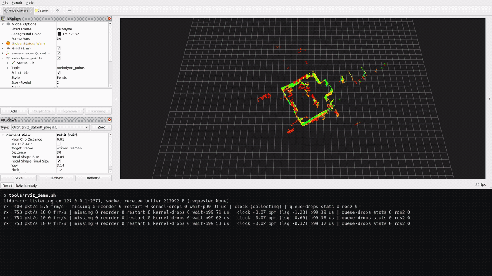
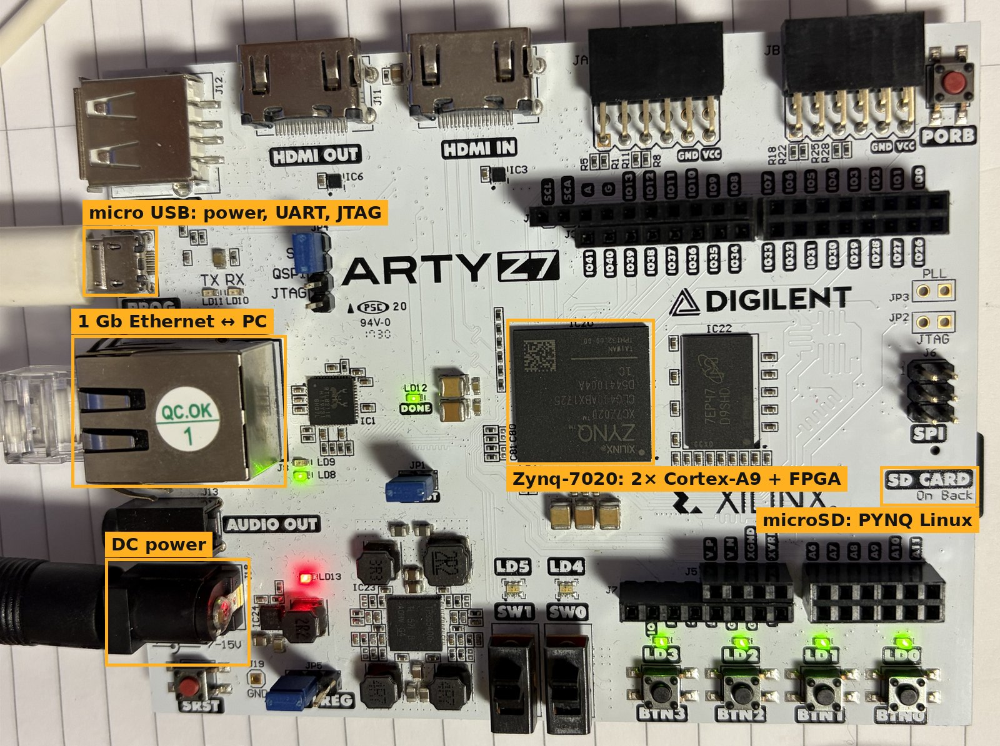
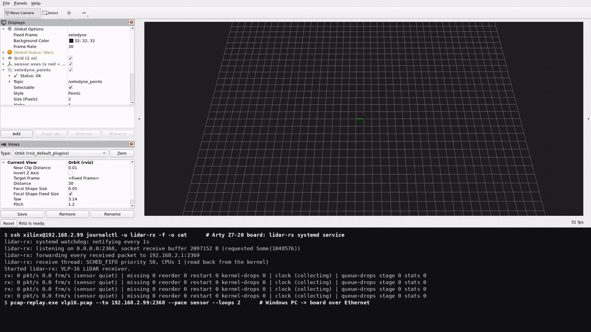
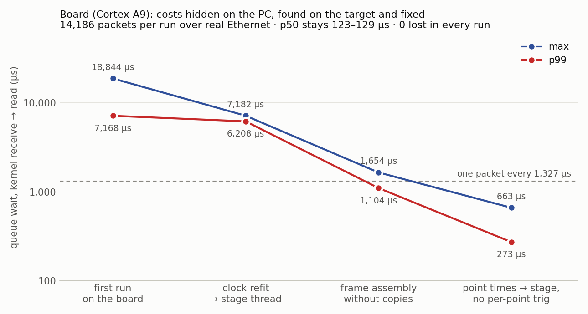
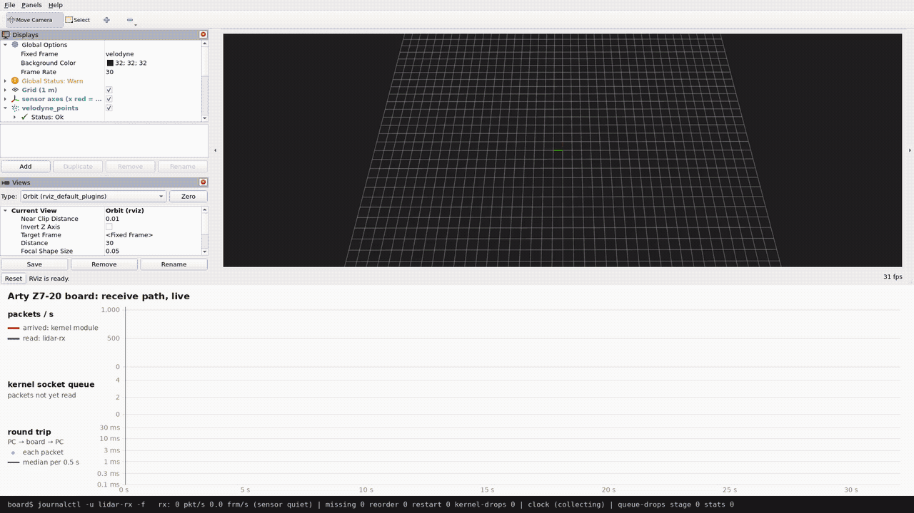

# lidar-rx

[](https://github.com/hjhgreen96/lidar-rx/actions/workflows/ci.yml)

Velodyne VLP-16 LiDAR 수신기 (Rust, C 커널 모듈): 커널 수신 경로 계측, 패킷 해석, 시계 추정, ROS 2 `PointCloud2` 발행

```text
 vlp16.pcap ─► pcap-replay ─UDP─► [커널: NIC → IP ─► 관찰 모듈 → UDP → 소켓] ─► lidar-rx ─► ROS 2 ─► RViz
 (실제 캡처)   (센서 대신)                                                    해석 → 프레임 → 시계 추정 → PointCloud2
```

- 실제 VLP-16 캡처를 센서 간격(754 pkt/s)으로 재생
- 수신, 해석, 프레임 조립, 센서/호스트 시계 추정, ROS 2 발행
- 커널 모듈(netfilter)로 IP 계층 패킷 수와 앱 수신 수 대조
- Arty Z7-20 (Zynq-7020, Cortex-A9)에서 실제 Ethernet 수신, systemd 서비스

## 데모

### PC (WSL2)



- 영상: [demo.mp4](docs/media/demo.mp4) (1920×1080, 35초)
- 위 RViz, 아래 lidar-rx 상태 출력
- 1부: 원래 간격 재생 - 754 pkt/s, 10 frm/s, 손실 0, `clock` ≈ 0 ppm (같은 컴퓨터에서 송수신)
- 2부: `--drift-ppm 100`으로 재시작 - 재시작 감지(`restart 1`), `clock` **+100.0 ppm**으로 수렴

### 보드 (Arty Z7-20)





- 영상: [board_demo.mp4](docs/media/board_demo.mp4) / 기록: [docs/runs/5-board.md](docs/runs/5-board.md)
- Windows PC → Ethernet → 보드 lidar-rx (PYNQ Linux 5.15, systemd)
- 보드에 ROS 2가 없어 받은 패킷을 PC로 전달(`--forward`), RViz는 PC
- 14,186개 손실 0, 커널 모듈 계수 = 앱 수신 수

#### 보드에서 찾고 고친 것



- PC에서 안 보이던 비용이 실시간 수신 스레드를 막음: 프레임 조립 7 ms, 시계 재추정 20 ms, 포인트별 삼각함수
- 큐 대기 p99 **7.2 ms → 0.27 ms**, 수신 스레드 CPU 22% → 16% ([5-board.md](docs/runs/5-board.md) 7절)
- 배열 재사용 후 수신 스레드 page fault 1,700/s → 0 (시작 직후 제외, 11절)
- 실험 1~4 보드 재측정 ([experiments.md](docs/modules/experiments.md))
- 그림: [수신 경로와 단계별 실측값](docs/media/board_receive_path.png) / [실험 1](docs/media/board_vs_wsl_exp1.png) / [실험 2](docs/media/board_queue_fill.png) / [실험 3, 4](docs/media/board_vs_wsl_exp34.png) / [RViz 점 색: 측정 시각, 레이저 번호](docs/media/rviz_time_ring.mp4)

#### 실시간 수신 그래프



- 영상: [board_live.mp4](docs/media/board_live.mp4)
- 0.1 s 간격: 커널 모듈 계수, lidar-rx 수신 수, 소켓 큐
- 패킷별 왕복 시간: PC → 보드 → PC (송수신 시각 모두 Windows 시계)
- 0.8 s 끊김: 도착과 수신이 동시에 0 → 바로 회복
- 미전송 603 = 커널 모듈 lost 603 = lidar-rx missing 603
- 큐 최대 1, 왕복 중앙값 0.39 ms (왕복 꼬리는 Windows 쪽, [5-board.md](docs/runs/5-board.md) 11절)

## 설치

- Ubuntu 22.04 (Windows는 WSL2 Ubuntu 22.04, RViz는 WSLg)

```bash
# Rust
curl --proto '=https' --tlsv1.2 -sSf https://sh.rustup.rs | sh

# ROS 2 Humble + RViz + libclang (ROS 2 메시지 바인딩 생성)
sudo apt install -y software-properties-common curl
sudo add-apt-repository -y universe
VER=$(curl -s https://api.github.com/repos/ros-infrastructure/ros-apt-source/releases/latest | grep -F '"tag_name"' | awk -F'"' '{print $4}')
curl -L -o /tmp/ros2-apt-source.deb \
  "https://github.com/ros-infrastructure/ros-apt-source/releases/download/${VER}/ros2-apt-source_${VER}.jammy_all.deb"
sudo apt install -y /tmp/ros2-apt-source.deb
sudo apt update
sudo apt install -y ros-humble-ros-base ros-humble-rviz2 libclang-dev clang
sudo apt install -y ros-humble-velodyne       # 공식 드라이버 비교용 (tools/compare_official.sh)

# 저장소, 샘플 데이터 (ROS 공식 서버의 VLP-16 캡처, 9 MB)
git clone https://github.com/hjhgreen96/lidar-rx.git
cd lidar-rx
tools/fetch_data.sh
```

## 실행

### 데모

```bash
tools/rviz_demo.sh
```

- 첫 실행 시 빌드 1~2분
- 구성:

  ```text
   pcap-replay ──UDP 127.0.0.1:2368──► lidar-rx --ros2 ──/velodyne_points──► RViz
   센서 간격으로 반복 전송               수신 → 해석 → 프레임 조립             설정: tools/rviz/lidar.rviz
                                       → 시계 추정 → ROS 2 발행              (좌표계 velodyne, 반사율 색)
  ```

- 종료: RViz 창 닫기

### 화면

RViz

- 센서 축: 빨강 = 앞(x), 초록 = 왼쪽(y), 바닥 1 m 격자
- 방의 벽과 물체, 색은 반사율
- 10 Hz 갱신 (센서 회전 주기)
- Displays의 `velodyne_points`: **Status: Ok**
- 마우스: 왼쪽 드래그 회전, 휠 확대/축소, Shift + 왼쪽 드래그 이동

상태 출력 (2초 간격)

```text
rx: 754 pkt/s 10.0 frm/s | missing 0 reorder 0 restart 0 kernel-drops 0 wait-p99 57 us | clock +0.01 ppm (lsq +0.07) p99 28 us | queue-drops stats 0 ros2 0
     │          │            │                            │               │                 │                                      │
     │          │            │                            │               │                 │                                      └ 느린 소비자 때문에 버린 프레임
     │          │            │                            │               │                 └ 센서 시계와 호스트 시계의 빠르기 차이 (추정)
     │          │            │                            │               └ 커널 수신 → lidar-rx 읽기까지 대기 시간 (99% 지점)
     │          │            │                            └ 수신 버퍼가 넘쳐 커널이 버린 패킷
     │          │            └ 센서 타임스탬프 간격으로 판정한 손실 패킷
     │          └ 프레임 수/초 (VLP-16 600 rpm = 10 Hz)
     └ 패킷 수/초 (VLP-16 = 약 754)
```

### 시계 드리프트

```bash
tools/rviz_demo.sh --drift-ppm 100
```

- 센서 시계가 호스트 시계보다 100 ppm(1초에 100 µs) **느린** 상황: 센서 시각 1초 간격을 1.0001초에 걸쳐 전송
- `clock`이 몇 초 안에 **+100 ppm**으로 수렴 (양수 = 호스트 시계가 빠름)
- 화면 변화 없음, 포인트 시각을 호스트 시계로 옮기는 계산만 드리프트를 따라감
- 뒤 인자는 `pcap-replay`로 전달

### 개별 실행

- 터미널 3개, 각각 `cd lidar-rx` 후:

| 터미널 | 명령 | 역할 |
|---|---|---|
| 1 | `tools/build_rx_ros2.sh`  (최초)<br>`source /opt/ros/humble/setup.bash`<br>`target/ros2/release/lidar-rx --udp 127.0.0.1:2368 --ros2` | 수신, 해석, ROS 2 발행 |
| 2 | `cargo build --release -p pcap-replay`  (최초)<br>`target/release/pcap-replay data/vlp16.pcap --pace sensor --loops 0` | 센서 대신 전송 (무한 반복) |
| 3 | `source /opt/ros/humble/setup.bash`<br>`rviz2 -d tools/rviz/lidar.rviz` | 화면 |

- 종료: 각 터미널 Ctrl+C
- 설정 파일 없이 `rviz2`만 실행한 경우: Fixed Frame `velodyne`, **Add** → **By topic** → `/velodyne_points` → PointCloud2
- ROS 2 확인 (`source /opt/ros/humble/setup.bash` 후):

```bash
ros2 topic hz /velodyne_points             # 약 10 Hz
ros2 topic info -v /velodyne_points        # 발행자 QoS: RELIABLE
ros2 topic echo --once --no-arr /velodyne_points   # 헤더, 필드 구성(x y z intensity ring time)
```

### 문제 해결

| 증상 | 원인 / 해결 |
|---|---|
| RViz **Global Status: Warn** (`No tf data`) | 정상. TF 발행 노드가 없어서 생기는 경고, 메시지와 Fixed Frame이 모두 `velodyne`라 표시에는 문제 없음 |
| RViz 창이 안 뜸 | `echo $DISPLAY`가 비어 있으면 GUI 없는 환경, WSL이면 WSLg 지원 버전 확인 |
| 창이 검게 나오거나 바로 꺼짐 | `export LIBGL_ALWAYS_SOFTWARE=1` 후 재실행 (소프트웨어 렌더링) |
| `velodyne_points` 경고, 점 없음 | replay 실행 여부, Fixed Frame `velodyne` 확인 |
| `built without the ros2 feature` | ROS 2 없이 빌드한 `target/release/lidar-rx` 실행, ROS 2용은 `target/ros2/release/lidar-rx` |
| `Address already in use` | 이전 lidar-rx 실행 중 → `pkill lidar-rx` |

## 보드에서 실행

- 설치를 마친 PC(Windows + WSL2)와 보드를 Ethernet으로 직결

```text
 Windows  pcap-replay.exe ──Ethernet──► 보드 192.168.2.99:2368   lidar-rx 서비스 (부팅 시 시작, --forward 192.168.2.1:2369)
          (센서 대신 전송)                                         │ 받은 패킷
 Windows  pcap-replay.exe --echo :2369 ◄──────────────────────────┘
            └ --echo-relay ──► WSL lidar-rx --ros2 ──► /velodyne_points ──► RViz      (보드에는 ROS 2 없음)
```

### PC 설정

```bash
# 크로스 빌드: 보드용(ARMv7, musl 정적 링크), Windows용 pcap-replay.exe (.cargo/config.toml)
rustup target add armv7-unknown-linux-musleabihf x86_64-pc-windows-gnu
sudo apt install -y gcc-arm-linux-gnueabihf gcc-mingw-w64-x86-64
```

- Windows 관리자 PowerShell (어댑터 이름은 `Get-NetAdapter`, 여기서는 "이더넷"):

```powershell
# 보드와 연결한 USB Ethernet 어댑터에 고정 IP (보드 PYNQ 기본값 192.168.2.99와 같은 대역)
New-NetIPAddress -InterfaceAlias "이더넷" -IPAddress 192.168.2.1 -PrefixLength 24
# 보드가 전달한 UDP 2369 허용 (Windows 10의 WSL2는 외부 UDP를 직접 못 받아 Windows가 받아서 전달)
New-NetFirewallRule -DisplayName "lidar-rx board relay (UDP 2369 from 192.168.2.0/24)" -Direction Inbound `
  -Protocol UDP -LocalPort 2369 -RemoteAddress 192.168.2.0/24 -Action Allow
```

### 보드 설정

| 항목 | 방법 |
|---|---|
| SD 카드 | PYNQ-Z1 v3.0.1 이미지를 microSD에 기록, JP4를 SD로 (8 GB 카드는 v3.1.1 용량 부족) |
| 연결 | 보드 USB(전원 + 시리얼), 보드 Ethernet ↔ PC USB Ethernet 어댑터, `ping 192.168.2.99` |
| ssh 키 | WSL에서 `ssh-copy-id xilinx@192.168.2.99` (비밀번호 `xilinx`) |
| 커널 모듈 (선택) | [tools/board/build_kmod.sh](tools/board/build_kmod.sh) 머리말 순서로 보드에서 빌드 → `kmod/board/lidar_mon.ko`. 없어도 서비스 동작 (커널 모듈 대조만 빠짐) |
| 설치 | WSL: `tools/board/bundle.sh && scp target/board/lidar-rx-board.tar.gz xilinx@192.168.2.99:`<br>보드: `tar xzf lidar-rx-board.tar.gz && cd lidar-rx-board && sudo deploy/install.sh && sudo systemctl enable --now lidar-rx` |
| 실행 인자 | 보드 `/etc/lidar-rx/lidar-rx.env` 수정 후 `sudo systemctl restart lidar-rx`<br>`LIDAR_RX_ARGS=--udp 0.0.0.0:2368 --rcvbuf 1048576 --status 2 --cpu 1 --rt-prio 50 --lock-memory --forward 192.168.2.1:2369`<br>설치 기본값에 추가: 상태 출력 2초 간격, 메모리 고정, PC로 전달 |

### 실행

1. 보드 USB 연결, 부팅 약 1분 30초 (모듈, 서비스 자동 시작)
2. WSL에서:

   ```bash
   tools/board_demo.sh                 # 100회 반복 전송(약 16분), 뒤 인자는 pcap-replay.exe로 (--loops 300: 약 47분)
   tools/board_demo.sh --gap 12:0.8    # 전송 12 s 후 0.8 s 끊기 (케이블을 뽑은 것처럼)
   ```

   - RViz 창 + 터미널에 보드 서비스 로그 (2초 간격)

   ```text
   rx: 754 pkt/s 10.0 frm/s | missing 0 reorder 0 restart 0 kernel-drops 0 wait-p99 275 us | clock -1.22 ppm (lsq -1.21) p99 47 us | queue-drops stage 0 stats 0
   ```

   - 보드(Cortex-A9) 754 pkt/s 손실 0, 커널 수신 → 읽기 대기 p99 0.28 ms
   - `--gap`: 그 순간 `missing` 603 증가, 바로 754 pkt/s로 회복
3. 종료: RViz 창 닫기 (보드 서비스는 계속 실행)

### 문제 해결 (보드)

| 증상 | 원인 / 해결 |
|---|---|
| `board not reachable or lidar-rx not running` | 부팅 중(전원 투입 후 1분 30초 미만), 또는 PC 어댑터 고정 IP 사라짐(169.254.x만 남는 경우) → `Get-NetIPAddress -InterfaceAlias "이더넷"` 확인 후 `New-NetIPAddress` 재실행 |
| 보드 로그는 754 pkt/s인데 RViz에 점 없음 | Windows 방화벽의 2369 차단 → 방화벽 규칙 확인. PowerShell 스크립트로 전달하면 안 됨: 방화벽 첫 확인 창에서 개인 네트워크만 고르면 powershell.exe의 공용 네트워크 수신 차단 규칙이 생기고(차단 규칙이 허용 규칙보다 우선), 보드 어댑터는 공용. 그래서 `board_demo.sh`는 `pcap-replay.exe`로 전달 |
| 보드 리셋 반복 | USB 전원 부족 → `reboot` 대신 USB 재연결, 장시간 사용은 외부 전원 (DC 7~15 V, JP5 = REG) |
| `Address already in use` | 이전 WSL lidar-rx 실행 중 → `pkill lidar-rx` |

- 과정과 실측: [docs/runs/5-board.md](docs/runs/5-board.md) (부팅, 모듈 빌드, 설치, 찾고 고친 것, 실시간 그래프)

## 기타

```bash
cargo test --workspace                                   # 테스트 67개 (참조 구현과 포인트 단위 대조 포함)
cargo run --release -p rx -- --pcap data/vlp16.pcap      # ROS 2 없이 파일 해석: 프레임, 손실, 시계 추정 요약
tools/known_drift.sh 100 3                               # 시계 시험: 넣은 +100 ppm 복원 여부
tools/compare_official.sh                                # 공식 velodyne 드라이버와 포인트 수 비교 (ros-humble-velodyne 필요)
```

### 골든 파일 재생성

- 참조 구현(velodyne_decoder 3.1.0) 출력 → `testdata/golden_vlp16.csv` (저장소에 포함, 재생성할 때만 필요)

```bash
sudo apt install -y python3-venv
python3 -m venv tools/.venv && tools/.venv/bin/pip install -r tools/requirements.txt
```

### 커널 모듈, 수신 경로 실험 (WSL2)

- 실행 중 커널과 같은 소스, 설정, 컴파일러로 만든 커널 트리 필요 (WSL 커널은 심볼 체크섬 검사 사용)
- 커널 전체 빌드 1회 (오래 걸림, 메모리 16 GB에서 확인)
- 배경: [docs/modules/tools.md](docs/modules/tools.md#wsl-커널-빌드---wsl-kernelbuildsh) / 실제 출력: [docs/runs/0-kernel.md](docs/runs/0-kernel.md)

```bash
# 빌드 도구 + 실행 중 커널(GCC 13.2)과 같은 계열의 gcc-13 (Ubuntu 22.04 기본은 11)
sudo apt install -y build-essential flex bison bc libelf-dev libssl-dev dwarves cpio kmod
sudo add-apt-repository -y ppa:ubuntu-toolchain-r/test && sudo apt install -y gcc-13

tools/wsl-kernel/build.sh config      # 소스 받기(~/src) + 실행 중 커널 설정 적용 + 버전 문자열 확인
tools/wsl-kernel/build.sh build       # 전체 빌드 (Module.symvers 확보, 1회)

make -C kmod && sudo insmod kmod/lidar_mon.ko            # 커널 모듈
cat /proc/lidar_mon                                      # IP 계층 계수, 손실
cargo build --release -p rx -p pcap-replay
sudo tools/exp1_rcvbuf.sh 1000                           # 실험 1, 2: 소켓 버퍼 용량, 버퍼 = 지연 (약 1분 30초)
tools/exp3_inline_threaded.sh                            # 실험 3: 느린 소비자 - inline vs threaded (모듈 불필요)
sudo tools/exp4_sched.sh                                 # 실험 4: 같은 CPU 부하에서 일반 정책 vs SCHED_FIFO
```

### systemd 서비스 (WSL2)

- 수신, 녹화 서비스 2개: 준비 알림(`Type=notify`), watchdog, 재시작, SIGTERM 시 요약 출력 후 종료
- 설계, 확인 결과: [docs/modules/deploy.md](docs/modules/deploy.md)

```bash
tools/build_rx_ros2.sh && make -C kmod
sudo deploy/install.sh                                   # 사용자 lidar, 실행 파일, 설정, 모듈 자동 적재, 서비스
sudo systemctl enable --now lidar-rx lidar-record
deploy/status.sh                                         # 상태 (재시작 횟수, 상태 출력)
journalctl -u lidar-rx -f
sudo deploy/uninstall.sh --purge                         # 제거 (실험 스크립트와 같은 포트 2368 사용)
```

- 단계별 실제 출력: [docs/runs/](docs/runs/README.md) (터미널 영상 포함)

## 구성

```text
crates/
  lidar-core     경계 trait: PacketSource, SensorDecoder, Frame
  vlp16          VLP-16 해석, 프레임 조립 (참조 구현과 포인트 54,952개 일치)
  lidar-io       pcap 읽기, UDP 수신 (커널 수신 시각, 소켓 드롭 수), 패킷 전달
  clock          센서 시계 → 호스트 시계 추정
  pcap-replay    원래 간격 또는 드리프트 재생, 왕복 시간 측정
  rx             lidar-rx: 수신 루프, stage 스레드, 소비자 스레드, ROS 2 발행
kmod/            lidar_mon 커널 모듈 (netfilter PRE_ROUTING 계수, /proc/lidar_mon)
deploy/          systemd 서비스, 설치 스크립트
tools/           데모, 실험, 보드 배포, 커널 빌드 스크립트
docs/            설계 문서, 실행 기록, 그림, 영상
```

## 문서

- [docs/index.md](docs/index.md)

## 데이터

- 샘플: [ROS 공식 서버의 VLP-16 캡처](http://download.ros.org/data/velodyne/vlp16.pcap) (9.41초, 데이터 패킷 7,093개), `data/`에 받음 (git 제외)
- 참조 구현: [velodyne_decoder](https://github.com/valgur/velodyne_decoder) 3.1.0, [ros-drivers/velodyne](https://github.com/ros-drivers/velodyne/tree/ros2) (ros2 브랜치, Humble 바이너리 2.5.1)

## 라이선스

- [MIT](LICENSE)
- 커널 모듈 `kmod/lidar_mon.c`만 GPL-2.0 (파일 첫 줄 SPDX 표기)
