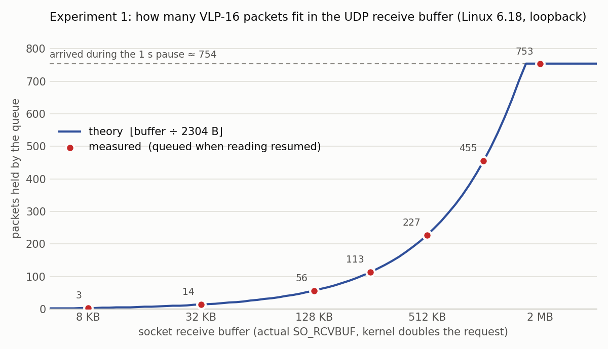
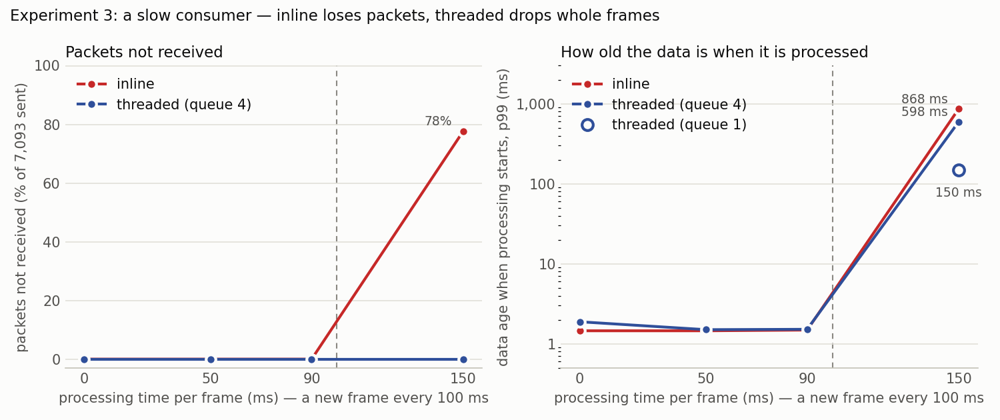
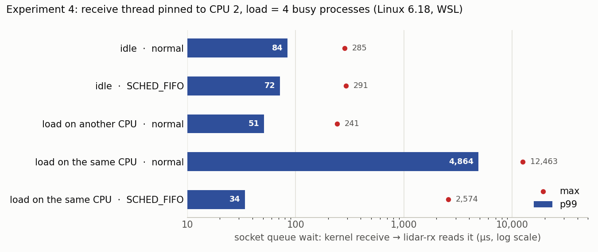
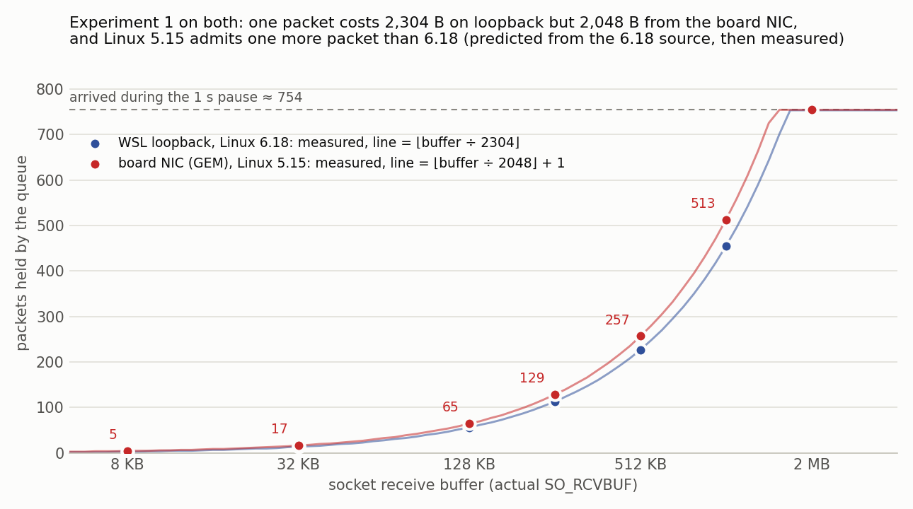
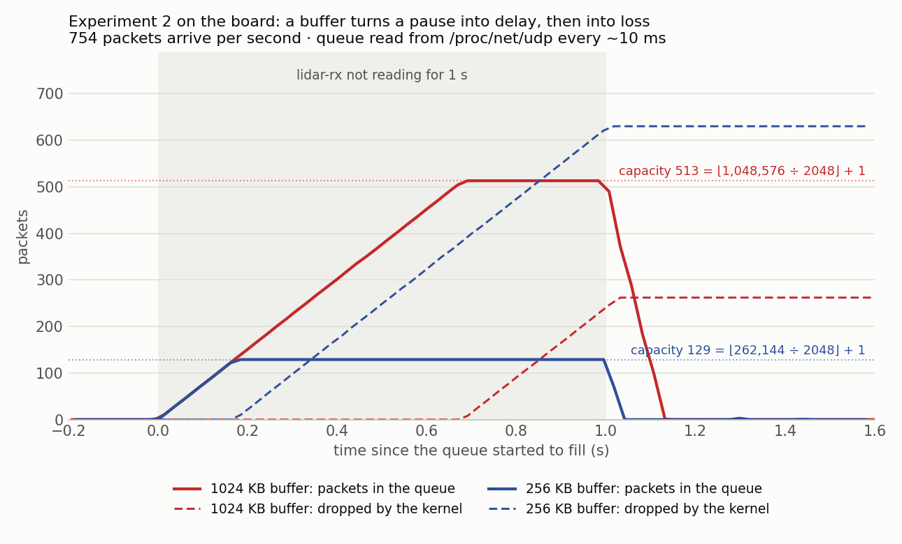
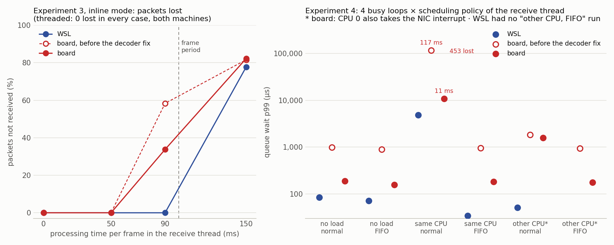

# 수신 경로 실험

커널이 패킷을 받아 lidar-rx가 꺼내기까지의 구간(소켓 수신 큐)에서 무슨 일이 일어나는지 측정한다.

| 실험 | 내용 | 상태 |
|---|---|---|
| 1 | 소켓 수신 버퍼 용량 | 완료 (WSL 커널 6.18, **보드 커널 5.15**) |
| 2 | 버퍼 = 지연, 대기 시간 | 완료 (실험 1과 같은 실행, WSL·보드) |
| 3 | 버리는 위치 (inline vs threaded) | 완료 (WSL, 보드) |
| 4 | 부하 속 수신 지연 (스케줄링 정책) | 완료 (WSL, 보드) |

보드(Arty Z7-20, 실제 Ethernet)에서 다시 한 결과는 아래 [보드에서](#보드에서-2026-11-11-arty-z7-20-실제-ethernet) 절.

실행 기록(입력·출력): 실험 1·2 [docs/runs/3-kmod.md](../runs/3-kmod.md) · 실험 3·4 [docs/runs/3-exp34.md](../runs/3-exp34.md) ·
영상: [run3_kmod.mp4](../media/run3_kmod.mp4), [run3_exp34.mp4](../media/run3_exp34.mp4)

---

## 실험 1 - 소켓 수신 버퍼 용량

### 방법

```text
 pcap-replay ──754 pkt/s──► 소켓 수신 큐 ──► lidar-rx
                                             패킷 1500개를 받은 뒤 1초 동안 읽지 않음 (--stall-ms 1000)

 ─ 받는 중 ─┬──────────── 1초 쉼 ────────────┬─ 다시 받음 ──────────►
            │ 도착 약 754개                   │ 처음 꺼내는 패킷들 중 커널 수신 시각이 "다시 받은 순간"보다
            │ 큐가 차면 나머지는 커널이 버림   │ 앞선 것 = 쉬는 동안 큐에 남아 있던 수 = 큐 용량 (직접 셈)
```

수신 버퍼 크기(`SO_RCVBUF` 요청값)를 4 KB ~ 1 MB로 바꿔 가며 반복한다 (`sudo tools/exp1_rcvbuf.sh`).

### 버린 수, 네 군데에서 계수

```text
 ① 커널 모듈(IP 계층)이 본 수 − lidar-rx가 받은 수         IP 계층 이후에서 사라진 수
 ② SO_RXQ_OVFL                                          소켓이 버퍼 넘침으로 버린 누적 수
 ③ 트레이스포인트 skb:kfree_skb, reason SOCKET_RCVBUFF    커널이 패킷을 버릴 때 남기는 기록 (이유 번호는 커널마다
                                                         달라 트레이스포인트의 format 파일에서 읽음, 5.17부터)
 ④ 트레이스포인트 udp:udp_fail_queue_rcv_skb              UDP 큐에 넣기 실패
```

### 결과

| 요청 | 커널이 잡은 버퍼 | 큐 용량 (측정) | 이론 ⌊버퍼 ÷ 2304⌋ | 쉬는 동안 도착 | ① | ② | ③ | ④ |
|---|---|---|---|---|---|---|---|---|
| 4 KB | 8 KB | 3 | 3 | 753 | 750 | 750 | 750 | 750 |
| 16 KB | 32 KB | 14 | 14 | 753 | 739 | 739 | 739 | 739 |
| 64 KB | 128 KB | 56 | 56 | 753 | 697 | 697 | 697 | 697 |
| 128 KB | 256 KB | 113 | 113 | 753 | 640 | 640 | 640 | 640 |
| 256 KB | 512 KB | 227 | 227 | 754 | 527 | 527 | 527 | 527 |
| 512 KB | 1 MB | 455 | 455 | 754 | 299 | 299 | 299 | 299 |
| 1 MB | 2 MB | 753 | 753 (도착 수에서 막힘) | 753 | 0 | 0 | 0 | 0 |



- 네 군데의 버린 수가 모든 행에서 같다. 서로 다른 층(lidar_mon 커널 모듈, 소켓 옵션, 커널 트레이스포인트 두 개)이
  같은 사건을 같은 수로 셌다.
- 측정한 용량이 모든 행에서 ⌊커널이 잡은 버퍼 ÷ 2304⌋와 정확히 같다. 두 번 실행해 같은 숫자가 나왔다.

### ⌊버퍼 ÷ 2304⌋의 근거

**① 버퍼는 요청의 두 배**

`setsockopt(SO_RCVBUF, x)`는 먼저 `x`를 `net.core.rmem_max`(이 WSL은 4 MB)로
자른 다음 `2x`로 저장한다(커널 내부 회계용 여유). 그래서 실제 상한은 `2 × rmem_max` = 8 MB다.

**② 회계 단위: 페이로드가 아니라 skb 전체 크기(truesize)**

```text
 1206 B 페이로드 패킷 하나의 truesize (커널 6.18, loopback)

 ┌────────────── 2 KB 데이터 칸 (kmalloc 2048) ──────────────┐┌── struct sk_buff ──┐
 │ 여유 + Ethernet·IP·UDP 헤더 + 페이로드 1206 │ skb_shared_info 320 ││ 232 → 256 (캐시 라인) │
 └──────────────────────── 약 1.6 KB를 2 KB 칸에 ─────────────┘└────────────────────┘
                              2048 + 256 = 2304 B
```

`struct sk_buff`(232 B)와 `skb_shared_info`(320 B)의 크기는 빌드한 커널의 타입 정보에서 확인했다 (`pahole`).
페이로드 1206 B짜리 패킷이 버퍼를 2304 B씩 쓰는 셈이라, "버퍼 크기 ÷ 1206"으로 계산하면 용량을 거의 두 배로
잘못 잡는다.

**③ 판정식** (`net/ipv4/udp.c`의 `__udp_enqueue_schedule_skb`):

| 커널 | 판정 | 용량 |
|---|---|---|
| 6.18 (이 WSL) | 넣기 전에 `쌓인 양 + 이번 패킷 > 버퍼`면 버림 (큐가 비었으면 하나는 받음) | ⌊버퍼 ÷ truesize⌋ |
| 5.15 · 6.1 · 6.6 (보드 PYNQ v3) | `쌓인 양 > 버퍼`만 먼저 보고, 더한 뒤 `> 버퍼 + 이번 패킷`이면 버림 | ⌊버퍼 ÷ truesize⌋ + 1 |

→ 보드(5단계)에서 같은 실험을 하면 각 행이 하나씩 클 것으로 예측된다. 또 보드는 NIC 드라이버가 skb를 만들므로
truesize 자체가 달라질 수 있다.

## 실험 2 - 버퍼 = 지연

같은 실행에서, 쉬고 나서 처음 꺼낸 패킷은 998 ms를 기다렸다 (모든 행).

```text
 큐에 N개가 있다 = 가장 오래된 것은 N / 754 초 전 데이터
 커널이 잡은 버퍼 1 MB(요청 512 KB, 용량 455개)가 가득 차면 큐의 앞쪽은 455 / 754 ≈ 0.6초 전 장면
```

- 버퍼를 키우면 버리는 대신 오래된 데이터를 들고 있게 된다. 일시적인 멈춤은 흡수하지만, 처리가 계속 느리면
  결국 넘치고 그동안 데이터는 점점 오래된다.
- 평소(쉬지 않을 때) 큐 대기 시간: p50 31 µs, p99 58 µs, 최대 283 µs (7,093 패킷, lidar-rx 요약의 `queue wait`,
  [3-kmod.md](../runs/3-kmod.md)). 값은 실행마다 조금씩 다르다 (README 데모의 상태 줄 `wait-p99`는 56 ~ 60 µs, 시작 직후
몇 초는 62 ~ 91 µs).
  → 수신 스레드가 제때 꺼내는 한 소켓 큐는 거의 비어 있다.
- lidar-rx는 패킷마다 대기 시간(커널 수신 시각 `SO_TIMESTAMPNS` → 꺼낸 순간)을 재서 히스토그램으로 모은다
  (`crates/rx/src/histogram.rs`, 메모리 고정 약 20 KB).

## 실험 3 - 버리는 위치 (inline vs threaded)

### 방법

lidar-rx에 프레임마다 D ms 동안 CPU를 쓰는 소비자를 붙인다 (`--work-ms D`, `WorkConsumer`: 뒤따르는 인식 알고리즘
모사, 바쁜 대기). 프레임은 100 ms마다 하나 나오므로 D가 100 ms를 넘으면 소비자는 따라갈 수 없다. 그때 **무엇을
버리는지**가 두 방식에서 갈린다.

```text
 inline     수신 스레드: recv → 해석 → [소비자 D ms] → recv …   처리하는 동안 소켓을 비우지 못함
            → 소켓 버퍼가 차면 커널이 그때 도착한 패킷을 버림 (어느 패킷인지는 고를 수 없음) → 구멍 나거나 끊긴 프레임

 threaded   수신 스레드: recv → 해석 → 채널에 try_send → recv …  소켓은 늘 비워짐
            소비자 스레드: 채널(길이 N)에서 꺼내 D ms 처리
            → 채널이 차면 완성된 프레임 단위로 버림 (그 소비자 몫만, queue-drops)
```

replay가 7,093 패킷(9.4 s)을 센서 간격으로 보낸다 (`tools/exp3_inline_threaded.sh`, root 불필요). 소켓 버퍼는 기본값
212,992 B = 92 패킷 ≈ 122 ms.

### 결과 ([실행 기록](../runs/3-exp34.md), 재점검에서 지표를 고친 뒤 다시 기록)

| 방식 | 채널 | D (ms) | 받은 패킷 | 손실 판정 | 그중 소켓 넘침 | 소켓 대기 p99 | 처리한 프레임 | 그중 온전한 한 바퀴 | 버린 프레임 | 처리 시작 때 데이터 나이 p99 |
|---|---|---|---|---|---|---|---|---|---|---|
| inline | - | 0 | 7,093 | 0 | 0 | 0.1 ms | 96 | 94 | 0 | 1.5 ms |
| inline | - | 50 | 7,093 | 0 | 0 | 48.6 ms | 96 | 94 | 0 | 1.5 ms |
| inline | - | 90 | 7,093 | 0 | 0 | 88.1 ms | 96 | 94 | 0 | 1.5 ms |
| inline | - | **150** | **1,582** | **5,469** | 5,469 | 876.5 ms | 68 | **1** | 0 | **868 ms** |
| threaded | 4 | 0 ~ 90 | 7,093 | 0 | 0 | 0.1 ms | 96 | 94 | 0 | 1.5 ~ 1.9 ms |
| threaded | 4 | **150** | **7,093** | **0** | 0 | 0.1 ms | 68 | **66** | 28 | 598 ms |
| threaded | 1 | **150** | **7,093** | **0** | 0 | 0.1 ms | 65 | **63** | 31 | **150 ms** |



- 온전한 한 바퀴 = 0°에서 0°까지, 빠진 패킷 없음 (`Frame::stats.is_complete()`). 처음 조각(시작이 한 바퀴 중간)과
  끝 조각(입력이 끝나 내보낸 것) 2개는 한 바퀴가 아니라서 어느 행에서나 빠진다.
- 처음에는 "구멍 난 프레임"(빠진 패킷이 있는 프레임)으로 셌고 틀렸다 (재점검에서 고침). inline 150 ms에서 67개 중
  47개라고 나왔지만, 나머지 20개도 손실 지점에서 끊긴 한 바퀴의 조각이었다: 반 바퀴 넘게 빠지면 그 자리에서 끊으므로
  (vlp16.md "긴 손실") 새 조각은 빠진 패킷 0으로 시작한다. 또 손실 구간이 자르는 각도에 걸치면 빠진 패킷이 모두 앞
  프레임에 들어가, 뒤 프레임은 시작이 비었는데도 빠진 패킷 0이었다 (조립기에서 각도로 나누게 고침).
- 받은 패킷과 손실 판정의 차이: 손실은 받은 패킷 사이의 빈틈(센서 시각)으로 판정한다. 그래서 끝날 때 아직 큐에 남아
  있거나 마지막으로 읽은 패킷 뒤에 버려진 패킷은 어느 쪽에도 세지 않는다. inline 150 ms에서 1,582 + 5,469 = 7,051,
  나머지 42개가 그것이다. 그래프의 손실 비율은 보낸 수 − 받은 수로 그렸다 (77.7%).
- 여섯 번 돌린 범위 (기록한 실행 포함): inline 150 ms의 받은 패킷 1,534 ~ 1,582, 손실 판정 5,405 ~ 5,470, 처리한 프레임
  67 ~ 68, 그중 온전한 한 바퀴는 여섯 번 모두 1. threaded 4·150 ms의 데이터 나이 p99 549 ~ 598 ms. 나머지 행은 여섯 번
  모두 손실 0, 프레임 수·온전한 수 같음.
- 2026-11-11 지금 코드로 다시 (보드에서 찾은 비용을 고친 뒤, `docs/media/exp3_inline_threaded_20261111.csv`):
  threaded 행은 모두 위 범위 안 (150 ms에서 버린 프레임 28·31, 데이터 나이 p99 557·150 ms). inline 150 ms만 받은 패킷
  1,725 (위 범위 1,534 ~ 1,582 밖, 손실 75.7%), 처리한 프레임 67, 온전한 한 바퀴 1. 수신 스레드의 해석이 빨라져
  (PC에서 패킷당 6.7 → 4.1 µs) 처리가 끝난 뒤 쌓인 큐를 더 빨리 비우기 때문이다. 결론(inline의 대량 손실)은 같다.

### 해석

- D가 주기보다 짧으면(50·90 ms로 시험) inline도 손실이 없다. 소켓 버퍼(122 ms)가 소비자가 막고 있는 동안을 받아
  준다. 대신 패킷이 커널에서 D만큼 기다린다 (소켓 대기 p99 ≈ D). 버퍼는 손실을 지연으로 바꾼다 (실험 2).
- D가 주기를 넘으면 inline은 대부분의 패킷을 잃는다. 처리 시간이 1.5배일 뿐인데 보낸 패킷의 약 78%를 받지 못하고, 처리한 프레임
  68개 중 온전한 한 바퀴는 1개뿐이고, 처리하는 데이터는 0.9초 전 것이다. 버퍼가 늘 차 있어서, 소비자가 프레임 하나를
  처리하는 150 ms(그동안 패킷 약 113개 도착) 동안에는 수신 스레드가 직전에 꺼낸 만큼만 큐에 빈 자리가 있고, 나머지는
  커널이 버린다. 처리 한 번마다 평균 약 80개(5,469 ÷ 68)가 연달아 버려져 반 바퀴(약 38개)를 넘으므로, 프레임 대부분이
  손실 지점에서 끊긴 조각이 된다. 큐에 남은 패킷은 이미 오래된 것이라 처리하는 데이터의 나이가 소켓 대기 시간(876 ms)만큼
  된다.
- threaded는 패킷을 하나도 잃지 않는다. 따라갈 수 없는 만큼 완성된 프레임 단위로 버리고, 소비자가 받은
  프레임은 처음·끝 조각을 빼면 모두 온전하다. 무엇을 버릴지를 커널이 아니라 설계가 정한다.
- 채널 길이도 설계다. 길이 4면 소비자가 늘 4개 밀린 채로 돌아 처리하는 데이터가 약 4 × 150 = 600 ms 전 것
  (측정 549 ~ 598 ms). 길이 1이면 150 ms. 지금 채널은 차 있으면 지금 들어온(가장 새) 프레임을 버린다(`try_send`).
  그래서 길이 1이어도 소비자가 받는 것은 가장 최신이 아니라 자리가 빈 뒤 처음 온 프레임이고, 나이가 D까지 된다. 실시간
  인식처럼 "늘 최신 것 하나"가 중요한 소비자에게는 오래된 것을 새것으로 바꾸는 한 칸짜리 자리가 맞다 (ROS 2 QoS
  `KEEP_LAST`가 이쪽: 깊이를 넘으면 가장 오래된 것을 버림. 그러면 나이가 한 주기 100 ms 안 - 계산만 했고 구현하지 않음).
  녹화처럼 하나도 빠지면 안 되는 소비자는 길게(또는 다른 방식으로) 둔다.

## 실험 4 - 부하 속 수신 지연 (스케줄링 정책)

### 방법

```text
 CPU 2  ── lidar-rx 수신 스레드 (--cpu 2)  [+ 부하 same: CPU를 쉬지 않고 쓰는 프로세스 4개]
 CPU 3  ──                                 [+ 부하 other: 같은 것 4개]
 CPU 6  ── pcap-replay (taskset)
 측정: 큐 대기 시간 = 커널이 받은 시각(SO_TIMESTAMPNS) → 수신 스레드가 꺼낸 시각, 7,093 패킷의 분포
 정책: SCHED_OTHER(일반) / SCHED_FIFO 50 (--rt-prio 50, 수신 스레드 하나에만)
```

- 실시간 정책은 수신 스레드 하나에만 준다 (`crates/rx/src/sched.rs`). 프로세스 전체에 주면 소비자 스레드와 ROS 2/DDS
  스레드까지 올라가, 그들이 바쁠 때 다른 일을 굶긴다. 스레드는 만들어질 때 만든 스레드의 정책을 물려받으므로, 소비자
  스레드를 다 만든 뒤에 수신 스레드의 정책을 바꾼다.
- 적용한 정책과 CPU는 커널에서 다시 읽어 요약에 찍는다 (`receive thread: SCHED_FIFO priority 50, CPUs 2 (read back from
  the kernel)`). "설정했다"가 아니라 "적용됐다"를 확인하기 위해서다.
- 부하는 bash 무한 루프 (`taskset -c 2 bash -c 'while :; do :; done'`). `sudo tools/exp4_sched.sh` (SCHED_FIFO는 root 필요).
- 환경: WSL 커널 6.18, 선점 모드 `none`(`PREEMPT_DYNAMIC`, `/sys/kernel/debug/sched/preempt`), `HZ=250`,
  `RT_GROUP_SCHED` 꺼짐(cgroup 안에서도 실시간 정책 가능), `sched_rt_runtime_us` 950000 (실시간 작업이 1초에 0.95초까지만
  CPU를 씀).

### 결과 ([실행 기록](../runs/3-exp34.md), µs)

| 부하 | 정책 | p50 | p99 | 최대 | 손실 |
|---|---|---|---|---|---|
| 없음 | 일반 | 31 | 84 | 285 | 0 |
| 없음 | SCHED_FIFO | 30 | 72 | 291 | 0 |
| 다른 CPU | 일반 | 32 | 51 | 241 | 0 |
| **같은 CPU** | **일반** | 16 | **4,864** | **12,463** | 0 |
| **같은 CPU** | **SCHED_FIFO** | 14 | **34** | 2,574 | 0 |



여섯 번 돌린 범위 (기록한 실행 포함): 같은 CPU·일반 p99 4,864 ~ 5,632, 최대 11,263 ~ 13,145 / 같은 CPU·SCHED_FIFO
p99 31 ~ 38, 최대 235 ~ 5,024 / 나머지 p99 50 ~ 84.

2026-11-11 지금 코드로 다시 (`docs/media/exp4_sched_20261111.csv`): 같은 CPU·일반 p99 4,608 (위 범위보다 조금 낮음),
최대 12,531 / 같은 CPU·SCHED_FIFO p99 34, 최대 266 / 나머지 p99 52 ~ 56. 결론은 같다.

### 해석

- 부하 자체가 아니라 "같은 CPU"가 문제다. 다른 CPU에 같은 부하를 걸면 아무 영향이 없다.
- 같은 CPU에 부하가 있으면 일반 정책의 꼬리가 약 60 ~ 100배로 는다 (p99 50 ~ 84 µs → 약 5 ms). 일반 정책(CFS의 후속인 EEVDF)은
  CPU를 쓰는 프로세스들에게 시간을 공평하게 나눈다. 이 커널은 기본 시간 조각이 2.8 ms이고(`/sys/kernel/debug/sched/
  base_slice_ns`), `RUN_TO_PARITY`가 켜져 있어 깨어난 수신 스레드가 지금 돌고 있는 작업의 조각이 끝날 때까지 기다릴 수
  있다. p99 약 5 ms ≈ 조각 두 개.
- SCHED_FIFO는 깨어나는 순간 일반 작업에게서 CPU를 빼앗는다 → p99가 31 ~ 38 µs로 부하가 없을 때보다도 작다.
- 최대값은 SCHED_FIFO로도 다 잡히지 않는다 (실행마다 0.2 ~ 5 ms). 아래 재검에서 0.4 ms를 넘은 최대값은 모두 그 순간
  가상 CPU 자체가 멈춘 것이었다 (감시 스레드로 대조, 10회 중 해당 4회 모두). 그래서 결론은 p99로 내고, 최대값은 실제
  CPU인 보드(5단계)에서 다시 잰다.
- 중앙값은 부하가 있을 때 오히려 작다 (30 ~ 32 → 14 ~ 16 µs). CPU가 놀고 있으면 수신 스레드를 깨울 때 그 CPU부터 깨워야
  하기 때문으로 보인다 (가상 머신에서는 쉬고 있는 가상 CPU를 하이퍼바이저가 다시 돌려야 함. 부하가 있으면 CPU가 이미 돌고
  있다). 따로 재지는 않았다 - 추정.
- 손실은 어느 조건에서도 없다. 소켓 버퍼(122 ms)가 지연(최대 13 ms)보다 훨씬 크다. 이 정도의 스케줄링 지연은
  손실이 아니라 데이터의 나이로 나타난다 - 포인트를 다른 센서와 합칠 때 문제가 된다.
- 운영에서는 systemd 서비스의 `CPUAffinity=`·`Nice=`가 프로세스 전체에 걸리므로, 수신 스레드만 올리려면 이 코드처럼
  스레드 단위로 하고 `LimitRTPRIO=`(또는 `CAP_SYS_NICE`)로 권한만 준다 (4단계).

### 재검 - SCHED_FIFO에서도 남는 최대값의 원인

"가상 CPU가 Windows 쪽 사정으로 멈춘다"는 처음에는 가설이었다. 이것을 재고, 리눅스 안에서 막을 방법이 있는지 확인했다.

도구 - `stall_detect` (`crates/rx/examples/stall_detect.rs`). 이 커널에는 같은 일을 하는 트레이서(`hwlat`,
`osnoise`, `timerlat`)가 빠져 있고, Hyper-V는 steal time도 알려 주지 않아(`/proc/stat`의 steal이 늘 0) 직접 만들었다.

```text
 CPU 하나에 고정한 스레드가 시계를 쉬지 않고 읽는다:  t₀ t₁ t₂ …… t₃ t₄
                                                      └ gap ┘  이 동안 이 스레드는 돌지 못했다
 SCHED_FIFO로 두면 그 CPU의 일반 작업에게 밀리지 않으므로, gap의 원인은 인터럽트(µs) 아니면 가상 CPU가 멈춘 것뿐.
 1초에 duty만큼만 돈다 (실시간 작업 제한 0.95 s/s)
```

**1) 방해 요소 없이도 생기는 CPU 멈춤** (CPU 2, SCHED_FIFO 50, 20 ~ 30초)

| 조건 | gap ≥ 100 µs | ≥ 1 ms | ≥ 5 ms | 최대 |
|---|---|---|---|---|
| Windows 한가함, 리눅스 부하 없음 | 11 ~ 12 /s | 0 ~ 0.1 /s | 0 | 0.3 ~ 1.3 ms |
| Windows 한가함, CPU 2에 부하 4개 | 11.7 /s | 0 | 0 | 0.36 ms |
| **Windows에 바쁜 프로세스 16개 (보통 우선순위)** | 62 /s | 62 /s | **62 /s** | **11.9 ms** |
| **같은 부하를 Windows 최저 우선순위(Idle)로** | 64 /s | 58 /s | **58 /s** | **12.1 ms** |

- Windows가 바쁘면 리눅스의 실시간 스레드도 1초에 약 60번, 한 번에 약 11.5 ms씩 멈춘다. 멈춘 시간이 1초에 약 0.7초
  (62번 × 11.5 ms)라 가상 CPU가 도는 시간은 약 30%로 준다. 같은 시간 동안 시계를 읽은 횟수는 378M → 92M(24%)으로 그보다
  더 줄었다. 리눅스의 우선순위는 여기에 아무 영향을 주지 못한다.
- 이 PC의 Hyper-V는 루트 스케줄러다 (Windows 이벤트 로그 "Hypervisor scheduler type is 0x4"). WSL의 가상 CPU 16개는
  Windows의 `vmmem` 프로세스 스레드로, Windows 스케줄러가 이 PC의 논리 CPU 16개(Ryzen 7 5700X)에 다른 프로그램과
  함께 배치한다. 가상 CPU 스레드의 Windows 우선순위는 15로 이미 높다 (`vmmem` 스레드 16개).
- 경쟁하는 Windows 작업을 최저 우선순위로 내려도 똑같이 멈춘다 → 단순한 우선순위 다툼이 아니다. 멈춤이 Windows 시계
  주기(15.6 ms, 64 Hz)마다 "약 5 ms 돌고 약 11.5 ms 멈춤"으로 반복되는 모양은, CPU를 나눠 쓸 때 VM 몫을 시계 주기
  단위로 제한하는 방식과 맞는다 (추정 - 관리자 권한 없이는 그 설정을 확인할 수 없었다).

**2) lidar-rx 최대값과 그 멈춤의 대조**

lidar-rx가 요약에 최대값을 꺼낸 시각을 함께 찍는다 (`max at … s`). 같은 CPU 2에 감시 스레드를 일반 정책으로 함께 돌려
그 자체를 부하로 쓰고(수신 스레드는 SCHED_FIFO 50이라 깨어나면 감시 스레드를 밀어냄), 최대값 순간을 덮는 gap을 찾는다.

| Windows | 10회 중 | lidar-rx p99 | lidar-rx 최대 | 그 순간 CPU 2의 멈춤 |
|---|---|---|---|---|
| 한가함 | 0.4 ms 넘는 최대값 4회 (471, 512, 700, 861 µs) | 39 ~ 45 µs | | **모두** 같은 순간 CPU 2가 그 이상 멈춤 (최대 대기의 114 ~ 209%) |
| 한가함 | 나머지 6회 (224 ~ 263 µs) | | | 2회는 덮는 멈춤 있음 (103 ~ 123%), 4회는 없음 |
| 바쁨 (3회) | | **10.5 ~ 10.6 ms** | **25.6 ~ 27.7 ms** | 9 ~ 27 ms짜리 멈춤이 겹침 (최대 대기의 33 ~ 103%) |

- 0.4 ms 넘는 최대값은 모두 수신 CPU 전체가 멈춘 시간이다 - 리눅스의 스케줄링이 늦은 것이 아니다.
- 덮는 멈춤이 없는 4회(약 0.23 ms)는, 보내는 쪽 CPU 6이 같은 식으로 멈춰 깨우기가 늦었을 가능성이 크다 (루프백에서는
  패킷을 소켓에 넣고 수신 스레드를 깨우는 일을 보낸 CPU가 한다). CPU 6은 감시하지 않았으므로 추정이다.
- Windows가 바쁘면 SCHED_FIFO의 p99조차 10 ms가 된다 - WSL에서 잰 지연은 Windows가 한가할 때만 리눅스의 성질이다.

**3) 재검 중 찾은 버그 - 정책과 CPU 고정의 순서** (고침)

감시 스레드를 실시간 정책(SCHED_FIFO 10, 1초에 90%)으로 돌렸더니 우선순위가 더 높은 수신 스레드가 p99 9 ~ 295 ms로
늦어졌다. 실시간 작업 제한을 꺼도(`sched_rt_runtime_us = -1`) 똑같아 제한 때문은 아니었다. 커널 스케줄러 이벤트를
추적해(잠들 때의 커널 스택 포함) 원인을 찾았다:

```text
 lidar-rx  off-CPU 591 ms, state D
   wait_for_completion ← affine_move_task ← __set_cpus_allowed_ptr      ← sched_setaffinity (CPU 2로 고정)
```

`sched::apply`가 CPU를 먼저 고정하고 그다음 SCHED_FIFO로 바꾸고 있었다. 옮기는 순간에는 아직 일반 정책이라, CPU 2를
실시간 작업이 쓰고 있으면 그 작업이 쉴 때까지 옮겨 가지 못한다. 그동안 패킷이 소켓 버퍼에 쌓이다 넘쳤다. 순서를 바꿔
(정책 먼저, 그다음 고정) 같은 조건 4회 모두 p99 31 ~ 33 µs로 돌아왔다. 원래 실험 4의 부하는 일반 정책 프로세스라 옮기기가
금방 끝났고, 수신 시작 전(replay보다 0.5초 먼저)이라 결과에는 영향이 없었다.

추적 팁: WSL의 배포판은 따로 PID 네임스페이스에서 돌아, 셸에서 보이는 PID(`$!`)가 커널 트레이스 이벤트의 PID와 다르다.
PID로 거르면 아무것도 안 잡히고, 스레드 이름(`prev_comm == "lidar-rx"`)으로 걸러야 한다.

**4) 대응 방법**

| 방법 | 결과 |
|---|---|
| 리눅스 안: SCHED_FIFO, CPU 고정 | 이미 적용. 가상 CPU가 멈추는 것은 리눅스가 알 수도 막을 수도 없다 |
| Windows 쪽 경쟁 작업의 우선순위를 낮춤 | **효과 없음** (위 표: Idle로 내려도 같음) |
| `vmmem`(가상 CPU)의 우선순위를 올림 | 일반 권한으로는 거부됨 ("Access is denied"). 가상 CPU 스레드는 이미 우선순위 15라 효과도 의문 - 시험하지 않음 |
| Hyper-V 스케줄러 종류를 바꿈 (`bcdedit /set hypervisorschedulertype core`) | 관리자 권한과 재부팅이 필요하고 WSL에서 일반적인 설정이 아님 - 시험하지 않음 |
| **측정할 때 Windows를 한가하게 두고, 감시 스레드를 함께 돌림** | 채택. 최대값마다 "가상 CPU가 멈춘 것인가"를 바로 가를 수 있다 |
| **가상화 없이 리눅스를 직접 돌림** (보드, 5단계) | 근본 해결. 남는 것은 리눅스 커널 쪽 지연뿐 (필요하면 PREEMPT_RT) |

결론: WSL에서는 리눅스 안의 방법으로 최대값을 막을 수 없다. 대신 최대값이 리눅스 밖의 원인이라는 것을 매번 확인할 수 있게
했고, 최대값의 숫자는 보드에서 낸다.

## 보드에서 (2026-11-11, Arty Z7-20, 실제 Ethernet)

```text
 Windows  pcap-replay.exe ──Ethernet 1 Gbps──► 보드 (Cortex-A9 ×2, PYNQ Linux 5.15) lidar-rx, 조건마다 새로
```

같은 실험을 보드에서 다시 했다. WSL과 다른 점:
보내는 쪽이 Windows이고 실제 NIC(Zynq GEM, `macb`)를 지난다. 보드 커널에는 tracepoint가 없어 실험 1의 버린 수는
① 모듈 ② `SO_RXQ_OVFL` ③ `/proc/net/udp` drops ④ `/proc/net/snmp` RcvbufErrors로 맞췄다 (②와 ③은 같은 커널 카운터
`sk_drops`를 두 길로 읽은 것). 실행마다 NIC 단계 앞뒤 차이(`ethtool -S`, eth0 인터럽트, `softnet_stat`)도 남겼다
(`docs/media/board_exp*_nic.txt`).

NIC 단계는 모든 실행에서 깨끗했다: 링·자원 부족 드롭(`rx_resource_errors`, `rx_overruns`, `q0_rx_dropped`)과
`softnet_stat`의 드롭·time_squeeze가 0. 받은 프레임은 실행마다 7,097 ~ 7,118 (보낸 7,093 + ssh 등 다른 트래픽),
eth0 인터럽트도 거의 같은 수라 패킷마다 인터럽트가 한 번 온다 (인터럽트 합치기 없음). 그래서 아래의 손실은 모두
소켓 버퍼에서 났다 (lidar-rx의 missing = kernel-drops).

### 실험 1·2 - 용량 (`docs/media/board_exp1.csv`)

| 커널이 잡은 버퍼 | 큐 용량 (측정) | ⌊버퍼 ÷ 2048⌋ + 1 | 큐가 찼을 때 rx_queue | 버린 수 ①②③④ | 가장 오래 기다린 패킷 |
|---|---|---|---|---|---|
| 8,192 | 5 | 5 | 10,240 B | 751 ×4 | 999 ms |
| 32,768 | 17 | 17 | 34,816 B | 737 ×4 | 999 ms |
| 131,072 | 65 | 65 | 133,120 B | 695 ×4 | 999 ms |
| 262,144 | 129 | 129 | 264,192 B | 633 ×4 | 999 ms |
| 524,288 | 257 | 257 | 526,336 B | 512 ×4 | 999 ms |
| 1,048,576 | 513 | 513 | 1,050,624 B | 271 ×4 | 999 ms |
| 2,097,152 | 754 (도착 수에서 막힘) | | | 0 | 999 ms |



- 보드 NIC 드라이버가 만든 패킷 하나는 2,048 B를 차지한다 (WSL loopback은 2,304 B): 큐가 찼을 때 `/proc/net/udp`의
  rx_queue가 정확히 "큐에 있던 수 × 2048". loopback은 보내는 쪽 소켓이 만든 skb가 그대로 오고, 보드는 NIC 드라이버가
  미리 할당한 수신 버퍼(1,536 B 데이터 칸 + 머리·꼬리)다.
- 5.15는 6.18보다 하나 더 담는다: 5.15는 `쌓인 양 > 버퍼`면 버리고, 아니면 더한 뒤 `> 버퍼 + 이번 패킷`일 때만 버린다
  (5.15 소스 `__udp_enqueue_schedule_skb`). 6.18 소스를 읽고 한 예측("각 크기에서 하나씩 더")이 일곱 크기 모두에서 맞았다.
- 같은 실험을 한 번 더 했을 때 131,072 줄만 64였다. 쉬기 직전에 읽었지만 아직 돌려주지 않은 패킷 하나가 그만큼 자리를
  차지한 것으로 본다 (아래).
- UDP는 읽은 패킷의 메모리를 바로 돌려주지 않는다 (`udp_rmem_release`): 큐에 쌓인 것을 reader 큐로 한꺼번에 옮겨 읽고,
  reader 큐가 빌 때까지 또는 버퍼의 1/4이 찰 때까지 모아서 돌려준다. 그래서 다시 읽기 시작한 직후에도 한동안 "가득 참"으로
  보여 몇 개를 더 버린다: "큐 + 버린 수"가 버퍼 1/4만큼 꺼내는 시간에 맞춰 754 → 784까지 늘었다 (1 MB에서 1/4 = 128개,
  보드에서 꺼내는 데 약 27 ms → 그동안 약 20 ~ 30개 도착). WSL은 꺼내는 속도가 빨라(패킷당 약 7 µs) 753 ~ 754 그대로였다.
- 실험 2: 1초 쉬면 가장 오래 기다린 패킷은 999 ms (WSL 998 ms). 버퍼가 얼마든 큐 맨 앞은 쉰 시간만큼 오래된 데이터다.
  쉬는 동안 큐를 약 10 ms마다 읽어 그리면(`docs/media/board_queue_fill.csv`) 큐는 초당
  754개 속도로 차오르다 용량(⌊버퍼 ÷ 2048⌋ + 1)에서 멈추고, 그 순간부터 버린 수가 같은 기울기로 오른다. 다시 읽기
  시작한 뒤에도 버린 수가 잠깐 더 오르는 것이 위의 메모리 반환 미루기다.



### 실험 3 - 느린 소비자 (`docs/media/board_exp3.csv`)

| 방식 | 처리 (ms) | 받은 패킷 | 손실 | 처리한 프레임 / 온전한 한 바퀴 | 버린 프레임 | 처리 시작 때 데이터 나이 p99 |
|---|---|---|---|---|---|---|
| inline | 0 / 50 | 7,093 | 0 | 96 / 94 | 0 | 6 ms |
| inline | 90 | 4,697 | **2,396 (34%)** | 96 / 4 | 0 | 89 ms |
| inline | 150 | 1,260 | 5,752 (82%) | 66 / 1 | 0 | 1,040 ms |
| threaded (채널 4) | 0 / 50 / 90 | 7,093 | 0 | 96 / 94 | 0 | 6 ms |
| threaded (채널 4) | 150 | 7,093 | 0 | 68 / 66 | 28 | 590 ms |
| threaded (채널 1) | 150 | 7,093 | 0 | 65 / 63 | 31 | 152 ms |



- threaded는 WSL과 같은 결과다 (손실 0, 150 ms에서 버린 프레임 28·31, 데이터 나이 590·152 ms - WSL 598·150 ms).
- inline은 처리 90 ms에서도 잃는다 (WSL은 150 ms부터). inline에서는 해석·시계 추정도 같은 스레드라, 처리 시간 예산은
  "프레임 주기 − 해석 비용"이다. 보드에서 해석은 프레임당 약 10 ms(고치기 전 약 18 ms)라 90 ms를 더하면 주기를 넘어
  조금씩 밀리다 넘친다 (해석기를 고치기 전에는 58% 손실). 같은 처리 시간이 PC에서는 괜찮고 보드에서는 아닌 이유다.

### 실험 4 - 부하 × 스케줄링 정책 (`docs/media/board_exp4.csv`, µs)

수신 스레드를 CPU 1에 고정. 부하 = CPU를 쉬지 않고 쓰는 bash 루프 4개. 보드는 CPU가 둘이고 **NIC 인터럽트와 softirq는
CPU 0**이 받는다 (WSL에서 "다른 CPU"는 아무 일도 안 하는 CPU였다).

| 부하 | 정책 | p50 | p99 | 최대 | 손실 | 해석기 고치기 전 p99 (손실) |
|---|---|---|---|---|---|---|
| 없음 | 일반 | 69 | 188 | 1,439 | 0 | 993 |
| 없음 | SCHED_FIFO | 68 | 158 | 484 | 0 | 900 |
| 같은 CPU(1) | 일반 | 83 | **10,880** | 31,785 | 0 | **116,736 (453)** |
| 같은 CPU(1) | SCHED_FIFO | 82 | 183 | 680 | 0 | 951 |
| 다른 CPU(0, NIC 인터럽트) | 일반 | 75 | 1,584 | 5,370 | 0 | 1,840 |
| 다른 CPU(0, NIC 인터럽트) | SCHED_FIFO | 73 | 175 | 244 | 0 | 936 |

- SCHED_FIFO면 어떤 부하에서도 p99 160 ~ 180 µs, 최대 0.7 ms 이하. WSL에서 최대값을 흔들던 가상 CPU 멈춤이 보드에는 없다.
- 같은 CPU 부하 + 일반 정책에서, 해석기를 고치기 전에는 수신 스레드가 굶었다 (p50 82 ms, 453개 손실). 스레드별 CPU 시간을
  재 보니 수신 스레드가 CPU의 22%를 썼고, 일반 정책에서 바쁜 작업 4개와 나누면 공평한 몫은 1/5 = 20%라 따라갈 수 없었다.
  포인트마다 부르던 삼각함수를 없애 16%로 줄이자 손실 0, p99 11 ms가 됐다 (남은 11 ms는 일반 정책에서 차례를 기다리는 시간.
  보드 커널은 틱이 10 ms). 수신 스레드에 실시간 정책을 주는 것과, 수신 스레드가 쓰는 CPU를 줄이는 것 둘 다 필요하다는 결과다.
- 다른 CPU(0)에 부하를 걸어도 일반 정책에서 p99가 1.6 ms로 오른다. CPU 0이 바쁘면 일반 정책인 stage·소비자 스레드가
  CPU 1로 옮겨 와 수신 스레드와 나눠 쓰기 때문이다: 같은 조건에서 0.25초마다 스레드의 CPU를 32번 읽었더니 stage·소비자
  스레드가 32번 모두 CPU 1에 있었다 (그 실행 p99 1.76 ms). 수신 스레드가 FIFO면 이들을 밀어내므로 175 µs.

## 다시 해 보기

```bash
cargo build --release -p rx -p pcap-replay && make -C kmod
sudo tools/exp1_rcvbuf.sh 1000          # 실험 1·2: 표 + docs/media/exp1_rcvbuf.csv (약 1분 30초)
tools/exp3_inline_threaded.sh           # 실험 3: 표 + docs/media/exp3_inline_threaded.csv (약 1분 45초)
sudo tools/exp4_sched.sh                # 실험 4: 표 + docs/media/exp4_sched.csv (약 1분)

# 실험 4 재검: 가상 CPU 멈춤과 lidar-rx 최대값의 관계
cargo build --release -p rx --example stall_detect
sudo target/release/examples/stall_detect --cpu 2 --seconds 30      # CPU 2가 멈춘 구간(gap) 분포
```

Windows 쪽 부하는 PowerShell에서 바쁜 프로세스 16개를 띄워 만들었다 (스스로 끝남):

```powershell
$cmd = '$e=(Get-Date).AddSeconds(48); while((Get-Date) -lt $e){}'
$p = 1..16 | % { Start-Process powershell -ArgumentList '-NoProfile','-Command',$cmd -WindowStyle Hidden -PassThru }
# $p | % { $_.PriorityClass = 'Idle' }     # 최저 우선순위로 시험할 때
```
