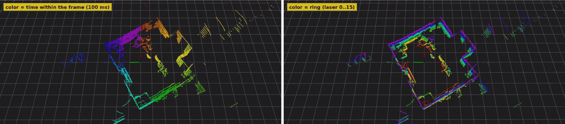

# `vlp16` - VLP-16 패킷 해석과 프레임 조립

UDP 페이로드 1206 B를 받아 포인트로 바꾸고, 한 바퀴씩 묶어 `lidar_core::Frame`으로 내보낸다.
소켓도 파일도 모르는 순수 계산이다.

- [1. 파일 지도](#1-파일-지도)
- [2. 패킷 바이트 구조 - packet.rs](#2-패킷-바이트-구조---packetrs)
- [3. 단위 타입 - units.rs](#3-단위-타입---unitsrs)
- [4. 발사 타이밍과 센서 시계 - timing.rs](#4-발사-타이밍과-센서-시계---timingrs)
- [5. 레이저, ring, 수직 오프셋 - calibration.rs](#5-레이저-ring-수직-오프셋---calibrationrs)
- [6. 방위각 보간 - geometry.rs](#6-방위각-보간---geometryrs)
- [7. 좌표 변환 - geometry.rs](#7-좌표-변환---geometryrs)
- [8. 패킷 하나 해석 - decode.rs](#8-패킷-하나-해석---decoders)
- [9. 프레임 조립 - assemble.rs](#9-프레임-조립---assemblers)
- [10. 묶음: Vlp16Decoder - lib.rs](#10-묶음-vlp16decoder---librs)
- [11. 참조 구현과의 차이와 대조 결과](#11-참조-구현과의-차이와-대조-결과)
- [12. 테스트 목록](#12-테스트-목록)
- [13. 직접 해 보기](#13-직접-해-보기)
- [14. 지원하지 않는 것](#14-지원하지-않는-것)

---

## 1. 파일 지도

```text
 crates/vlp16/src/
 ├── lib.rs          Vlp16Decoder (SensorDecoder 구현), Config, DecoderStats
 │
 │   ── 패킷 하나 (decode까지) ──────────────────────────────────────────────
 ├── packet.rs       바이트 배치, 검증, 복사 없이 읽는 창 (PacketView, Block, Channel)
 ├── units.rs        Azimuth(0.01°), RawDistance(2 mm) - 단위를 타입으로
 ├── timing.rs       발사 타이밍 상수, firing_offset_us, SensorClock(정시 넘김 펼치기)
 ├── calibration.rs  레이저별 수직각·수직 오프셋·ring
 ├── geometry.rs     회전 속도, 방위각 보간, ROS 좌표 변환, 자르는 각도 통과 판정
 ├── decode.rs       위를 조합: PacketView → DecodedPacket
 │
 │   ── 패킷 여러 개 (프레임) ───────────────────────────────────────────────
 └── assemble.rs     FrameAssembler: 손실·순서 판정, 발사 단위로 자르기, 대표 시각
```

의존 방향은 위에서 아래로만 간다: `decode`는 `packet`·`calibration`·`geometry`·`timing`을 쓰고,
`assemble`은 `decode`의 결과만 받는다. `assemble`은 바이트를 모른다.

## 2. 패킷 바이트 구조 - `packet.rs`

```text
  UDP 페이로드 1206 B
 ┌────────┬────────┬─────┬─────────┬───────────┬─────┬─────┐
 │ 블록 0 │ 블록 1 │  …  │ 블록 11 │ 타임스탬프 │ 반환 │ 제품 │
 │ 100 B  │ 100 B  │     │ 100 B   │   4 B     │ 모드 │ ID   │
 └────────┴────────┴─────┴─────────┴───────────┴─────┴─────┘
 0        100      200    1100      1200        1204  1205

  블록 하나 100 B
 ┌───────┬────────┬──────────────────────────────────────────────────────┐
 │ FF EE │ 방위각  │ 채널 0 │ 채널 1 │ … │ 채널 15 │ 채널 16 │ … │ 채널 31 │
 │ 2 B   │ 2 B    │ 3 B    │ 3 B    │   │         │         │   │         │
 └───────┴────────┴──────────────────────────────────────────────────────┘
  플래그   0.01° 단위   ├──── 첫 번째 발사 (레이저 0..15) ──┤├── 두 번째 발사 ──┤

  채널 하나 3 B:  거리 2 B (2 mm 단위, 0 = 반사 없음) + 반사율 1 B (0..255)
```

- 여러 바이트 값은 little-endian. 예: 방위각 바이트가 `39 30`이면 `0x3039` = 12345 → 123.45°.
- 타임스탬프: 이 패킷 첫 발사의 시각, 정시 이후 µs (0 .. 3,599,999,999).
- 반환 모드: `0x37` 가장 센 반사, `0x38` 가장 늦은 반사, `0x39` 둘 다(이중 반환).
- 제품 ID: 사양서상 VLP-16은 `0x22`. 샘플 pcap은 `0x21`(HDL-32E)로 찍혀 있지만 구조와 타이밍은
  VLP-16이다 (같은 레이저를 두 번 쏜 채널 i와 i+16의 거리 차 중앙값 8 mm, 서로 다른 레이저끼리는 286 mm).

### 코드

```text
 PacketView::parse(&[u8]) -> Result<PacketView, PacketError>
   1. 길이가 정확히 1206인가            → 아니면 PacketError::Length
   2. 블록 12개의 플래그가 FF EE인가     → 아니면 PacketError::BlockFlag
   3. 방위각이 36000 미만인가            → 아니면 PacketError::Azimuth
   4. 반환 모드가 아는 값인가            → 아니면 PacketError::ReturnMode
 검증을 통과한 뒤의 읽기 메서드(timestamp_us, block, channel …)는 실패하지 않는다.
```

`PacketView<'a>`는 원래 바이트 `&'a [u8; 1206]`를 빌려 보기만 한다. `'a`는 "원래 바이트가 살아 있는
동안만 이 창을 쓸 수 있다"는 표시로, 원래 버퍼가 사라진 뒤에 창을 쓰려 하면 컴파일 에러가 난다.
C에서 packed 구조체 포인터로 캐스팅하는 방식과 달리 정렬·엔디언·길이를 코드가 명시적으로 다룬다.

## 3. 단위 타입 - `units.rs`

```text
 Azimuth(u16)      방위각, 0.01° 단위. degrees(), forward_to(later)
 RawDistance(u16)  거리, 2 mm 단위.   meters(), is_no_return()
```

둘 다 속은 `u16`이지만 다른 타입이라 서로 바꿔 넣으면 컴파일 에러가 난다 (Newtype 패턴).
`forward_to`는 0°를 넘어가는 경우를 처리한다: 359.90°에서 0.30°까지는 40 (0.40°).

## 4. 발사 타이밍과 센서 시계 - `timing.rs`

### 발사 한 번

```text
 레이저 0  1  2  3 …  15                     레이저 0  1  2 …
   │  │  │  │      │                           │  │  │
 ──┴──┴──┴──┴─ … ──┴────────────────────────────┴──┴──┴── … ──► 시간
   ├2.304┤                                     │
   ├────── 16 × 2.304 = 36.864 µs ─────┤충전 18.432 µs│
   ├──────────────── 발사 주기 55.296 µs ──────────────┤
```

### 패킷 하나 = 발사 24회

```text
 블록      0          1          2       …      11
 발사    0    1    2    3    4    5     …    22   23
        ├────┼────┼────┼────┼────┼────  …  ──┼────┤
        0   55.3 110.6 …                         1271.8   1327.1 µs
        ↑ 타임스탬프                                        ↑ 다음 패킷 타임스탬프
```

```text
 firing_offset_us(발사, 레이저) = 발사 × 55.296 + 레이저 × 2.304     (µs, 패킷 타임스탬프 기준)
 PACKET_INTERVAL_US             = 24 × 55.296 = 1327.104 µs         (→ 약 753.5 패킷/초)
```

### 센서 시계 펼치기 - `SensorClock`

타임스탬프는 정시마다 0으로 돌아간다. 계속 증가하는 값이 필요하므로, 크게(30분 넘게) 뒤로 간 값이
오면 정시를 넘었다고 보고 1시간을 더해 간다.

```text
 원시값   … 3,599,998,000   3,599,999,327 │       654      1,981 …
 펼친 값  … 3,599,998,000   3,599,999,327 │ 3,600,000,654  3,600,001,981 …
```

조금 뒤로 간 값(순서 바뀜, 9.4초짜리 파일 반복 재생)은 정시 넘김이 아니므로 그대로 두고, 판단은
프레임 조립(9절)이 한다.

반대 방향도 있다: 정시를 넘긴 직후에 넘기기 전 패킷이 늦게 도착하면, 원시값이 크게(30분 넘게) 앞으로 뛴 것처럼
보인다. 이것은 지난 시간의 패킷이므로 `(지금 시간 − 1) × 1시간 + 원시값`으로 펼치고, 펼침 상태는 바꾸지 않는다.
이렇게 해야 조립 단계가 "조금 뒤로 간 패킷(순서 바뀜)"으로 본다. 1시간 가까이 앞으로 뛴 값으로 두면 흐름 재시작으로
오판해 모으던 프레임을 버린다. 커널 모듈(`kmod/lidar_mon.c`의 `lm_track`)도 같은 규칙을 쓴다.

```text
 원시값   … 3,599,999,327 │       654   3,599,998,000(늦게 옴)   1,981 …
 펼친 값  … 3,599,999,327 │ 3,600,000,654   3,599,998,000         3,600,001,981 …
                                            └ 앞으로 뛴 게 아니라 지난 시간의 값 → 조립에서 "순서 바뀜"
```

## 5. 레이저, ring, 수직 오프셋 - `calibration.rs`

### 레이저 번호와 ring

```text
  +15° ── 레이저 15 ── ring 15
  +13° ── 레이저 13 ── ring 14          레이저 번호 = 쏘는 순서 (위아래로 번갈아 쏨)
   …                                    ring        = 아래에서 위로 매긴 번호
   +1° ── 레이저 1  ── ring 8
   −1° ── 레이저 14 ── ring 7           위아래로 번갈아 쏘는 이유: 이웃한 각도의 레이저를
   …                                    연달아 쏘면 서로의 반사를 받을 수 있어서
  −13° ── 레이저 2  ── ring 1
  −15° ── 레이저 0  ── ring 0
```

| 레이저 | 0 | 1 | 2 | 3 | 4 | 5 | 6 | 7 | 8 | 9 | 10 | 11 | 12 | 13 | 14 | 15 |
|---|---|---|---|---|---|---|---|---|---|---|---|---|---|---|---|---|
| 수직각 (°) | −15 | 1 | −13 | 3 | −11 | 5 | −9 | 7 | −7 | 9 | −5 | 11 | −3 | 13 | −1 | 15 |
| ring | 0 | 8 | 1 | 9 | 2 | 10 | 3 | 11 | 4 | 12 | 5 | 13 | 6 | 14 | 7 | 15 |

`ring`은 수직각을 정렬해서 계산한다 (`rings_by_angle`). 표를 손으로 쓰지 않으므로 각도 표만 맞으면
ring은 저절로 맞는다.

### 수직 오프셋

레이저들은 센서 앞쪽의 한 점(초점)을 지나도록 배치돼 있어, 빔이 나오는 높이가 레이저마다 다르다.

```text
   옆에서 본 그림
                                  ↗  +15° 빔 (아래에서 나옴: −11.23 mm)
          센서 축 ──●────────────●
                    │            ↘  −15° 빔 (위에서 나옴: +11.23 mm)
                    ├── 41.91 mm ─┤
                   센서 중심      초점

   오프셋 = 초점 거리 × tan(−수직각)
   z = 거리 × sin(수직각) + 오프셋
```

계산값은 사양서 표(11.2, −0.7, 9.7, … mm)와 0.05 mm 안에서 같다 (테스트로 확인).
가까운 물체일수록 이 오프셋의 효과가 각도로 크게 보인다: 참조 출력에서 ring 0의 평균 수직각이
−15°가 아니라 −14.69°로 나오는 이유다.

## 6. 방위각 보간 - `geometry.rs`

블록에는 방위각이 하나뿐이다 (블록 첫 발사가 시작될 때). 하지만 센서는 계속 돌고 있으므로, 같은
블록 안에서도 나중에 쏜 레이저일수록 조금 더 돌아간 방향을 본다.

```text
  블록 b 방위각 A_b                                  블록 b+1 방위각 A_b+1
     │                                                  │
     ▼ 발사 2b                       ▼ 발사 2b+1        ▼
     ●●●●●●●●●●●●●●●●  (충전)        ●●●●●●●●●●●●●●●●  (충전)
     ↑레이저 0      ↑레이저 15       ↑ A_b + 회전 속도 × 55.296 µs
     A_b            A_b + 회전 속도 × 34.56 µs

  방위각 = 블록 방위각 + 회전 속도 × (블록 첫 발사로부터 경과 시간)
```

회전 속도 계산 방식이 구현마다 다르다.

| 방법 | 식 | 특징 |
|---|---|---|
| 블록마다 (사양서 예시, 공식 드라이버) | (A_b+1 − A_b) ÷ 110.592 µs. 마지막 블록은 앞 블록 값 | 블록 방위각이 0.01°로 잘려 있어, 약 0.4° 간격으로 구하면 ±2.5% 흔들림 |
| 패킷 평균 (여기, velodyne_decoder) | (A_11 − A_0) ÷ (22 × 55.296 µs) | 약 4.4° 간격으로 구하므로 흔들림 ±0.23%. 마지막 블록도 같은 식 |

```text
 rotation_rate(first, last)        = first.forward_to(last) / (22 × 55.296)    [0.01°/µs]
 azimuth_after(block, rate, dt_us) = (block + rate × dt_us) / 100  mod 360      [도]
```

## 7. 좌표 변환 - `geometry.rs`

```text
  센서 좌표 (사양서, 위에서 본 그림)           ROS 좌표 (REP-103, 위에서 본 그림)

            +y  방위각 0° (정면)                         +x (앞)
             ↑                                            ↑
             │  ↻ 방위각은 시계방향으로 증가               │
   ──────────┼──────────► +x                  +y ◄────────┼────────
             │                                (왼쪽)       │

  센서:  x_s = d·cosω·sinα    y_s = d·cosω·cosα    z_s = d·sinω + 오프셋
  ROS:   x = y_s = d·cosω·cosα
         y = −x_s = −d·cosω·sinα
         z = z_s
         (d: 거리, ω: 수직각, α: 방위각)
```

확인 방법: 방위각 0°(정면)이면 x가 양수이고 y는 0. 방위각 90°(위에서 보아 시계방향 = 오른쪽)이면
y가 음수 (ROS에서 +y는 왼쪽). `geometry.rs`의 `axes` 테스트가 이 두 경우를 확인한다.

## 8. 패킷 하나 해석 - `decode.rs`

```text
 decode_packet(packet, calibration, range) -> Result<DecodedPacket, DecodeError>

   이중 반환 모드면 → DecodeError::Unsupported
   회전 속도 = rotation_rate(블록 0 방위각, 블록 11 방위각)
   레이저 l = 0..16마다 한 번: δ_l = 회전 속도 × l × 2.304 µs, sin δ_l, cos δ_l     ← 패킷마다 16번
   블록 b = 0..12:
     블록 시작 시각 = firing_offset_us(2b, 0)
     발사 f = 0, 1  (패킷 안 발사 번호 = 2b + f):
       a = 레이저 0의 방위각 = azimuth_after(블록 방위각, 회전 속도, 발사 시각 − 블록 시작 시각)
       firing_azimuths[2b+f] = a                        ← 포인트가 없어도 기록 (프레임 경계용)
       sin a, cos a                                     ← 발사마다 한 번
       레이저 l = 0..16:
         채널 = 블록.channel(16f + l)
         거리 0이면 건너뜀 (반사 없음)
         거리가 범위 밖이면 건너뜀
         시각   = firing_offset_us(2b+f, l)
         방위각 = a + δ_l (360 이상이면 360을 뺌)
         sin·cos = 덧셈 공식: sin(a+δ) = sin a·cos δ + cos a·sin δ,  cos(a+δ) = cos a·cos δ − sin a·sin δ
         xyz    = to_ros_xyz_sincos(거리, sin, cos, 보정값[l])
         → RawPoint { 발사, 레이저, ring, 방위각, 거리, 반사율, xyz, 시각 }
```

출력 포인트는 발사 순서대로 정렬돼 있다. 프레임 조립이 이 순서에 기댄다.

삼각함수를 포인트마다 부르지 않는 이유 (2026-11-11, 보드에서 발견). 처음에는 포인트마다 방위각을 보간하고
`sin_cos`를 불렀다 (패킷당 384번). PC에서는 패킷 하나에 6.7 µs라 보이지 않았지만, 삼각함수 하드웨어가 없는
보드(Cortex-A9)에서는 212 µs였고 수신 스레드가 CPU를 22% 썼다. 같은 CPU에 일반 정책 부하 4개가 있으면 공평한 몫이
1/5 = 20%라 따라가지 못해 큐가 넘쳤다 (보드 실험 4, [experiments.md](experiments.md)). 한 발사 안에서 레이저마다 더 돈
각도 δ_l은 패킷 안에서 발사와 상관없이 같으므로, 삼각함수는 패킷마다 16 + 24번만 부르고 포인트마다는 곱셈 4번으로
합친다. 결과는 같다: 포인트마다 삼각함수를 부르는 방식과 방위각 1e-9°, 좌표 1e-5 m 안에서 일치(360° 넘김 포함,
`matches_trigonometry_per_point_including_the_wrap_at_360`), 참조 구현과의 골든 테스트도 그대로 통과.

## 9. 프레임 조립 - `assemble.rs`

### 어디서 자르나: 발사 단위

```text
       패킷 n−1               패킷 n                         패킷 n+1
  ┌──────────────┐ ┌───────────────────────────────────┐ ┌─────────────┐
  │ … 355° … 359°│ │ 359.6°  359.8°  │ 0.0°  0.2°  …  4.2°│ │ 4.4° …      │
  └──────────────┘ └─────────────────┼─────────────────┘ └─────────────┘
  ───────── 프레임 k ───────────────►│◄────────────── 프레임 k+1 ───────────
                                자르는 각도(0°)를 지난 발사
```

발사마다 `crossed(지난 발사 방위각, 이번 발사 방위각, 자르는 각도)`를 본다. 지났으면 그때까지 모은
것을 프레임으로 내보내고, 이번 발사부터 새 프레임에 넣는다. 그래서 경계에 걸친 패킷은 두 프레임 모두의
`packet_times`에 들어간다 (앞 프레임의 마지막 = 뒤 프레임의 첫 번째).

| `FrameStats` | 뜻 |
|---|---|
| `starts_at_cut` | 자르는 각도에서 시작했는가. 시작 직후·흐름 재시작 직후의 첫 프레임은 `false` |
| `ends_at_cut` | 자르는 각도에서 끝났는가. 입력이 끝나 `flush`로 내보낸 마지막 프레임은 `false` |
| `is_full_turn()` | 둘 다 `true` = 한 바퀴 범위 (그 안에 빠진 패킷이 있을 수 있음) |
| `missing_packets` | 아래의 손실 판정으로 이 프레임 범위에서 빠진 패킷 수 |
| `is_complete()` | 한 바퀴 범위이고 빠진 패킷 0 = 온전한 한 바퀴 |

참조 구현 두 개는 패킷 단위로 잘라 한 프레임에 최대 약 4.8°(패킷 하나)가 더 들어간다 (11절).

### 패킷 사이 간격을 센서 시각으로 확인

```text
                 Δ = 이번 패킷 시각 − 지난 패킷 시각
 ──────────────┬───────────────┬──────────────────────────┬───────────────► Δ
     −10 ms    0          1327 µs, 2654 µs, …             1 s
 ◄── 재시작 ──►│◄─ 순서 바뀜 ─►│◄── 정상 / k개 간격이면 k−1개 손실 ──►│◄── 재시작 ──►
               │  (버리고 셈)   │   missing_packets += round(Δ/1327.1)−1 │
```

| Δ | 판정 | 처리 |
|---|---|---|
| −10 ms < Δ ≤ 0 | 순서 바뀜·중복 | 이미 지난 자리라 버리고 `reordered_packets` 증가 |
| 0 < Δ ≤ 1 s | 정상 또는 손실 | `round(Δ / 1327.104) − 1`개를 모으는 프레임의 `missing_packets`에 더함 |
| Δ ≤ −10 ms 또는 Δ > 1 s | 흐름 재시작 | 모으던 프레임을 버림, `restarts` 증가. 다음 프레임은 `starts_at_cut = false` |

한계: 10 ms 넘게 늦게 온 패킷 하나도 재시작으로 본다. 그러면 모으던 프레임을 버리고, 그다음 정상 패킷은 그 늦은 패킷
기준으로 간격이 벌어져 손실처럼 세어진다 (실제로는 잃은 것이 없음). 센서와 직접 연결된 망에서는 이만큼 순서가 바뀌는
일이 없다고 보고 두었다. 커널 모듈도 같은 규칙이라 둘을 대조해도 드러나지 않는다. 막으려면 재시작을 바로 정하지 말고
다음 패킷이 새 흐름을 따르는지 보고 정해야 한다.

손실을 방위각이 아니라 센서 시각으로 판정하는 이유: 패킷 간격은 µs까지 일정하지만 방위각 간격은
회전 속도의 흔들림에 따라 달라진다.

빠진 구간 안에 자르는 각도가 있으면 빠진 패킷을 앞뒤 두 프레임에 각도로 나눠 센다 (`split_missing`). 빠진 발사는
빠지기 전 마지막 발사와 다시 받은 첫 발사 사이에 같은 간격으로 있었으므로, 자르는 각도 앞의 몫은 앞 프레임에, 뒤의 몫은
뒤 프레임에 더한다. 자르는 각도에 걸친 패킷은 양쪽 모두에서 빠졌으므로 양쪽에 센다.

```text
 패킷 15 ~ 20 손실, 자르는 각도 90°는 패킷 18 안
   앞 프레임 missing 4 (15·16·17·18)   뒤 프레임 missing 3 (18·19·20)   누적 카운터 6
```

나누지 않으면 뒤 프레임은 시작 부분(90 ~ 100.8°)이 비었는데도 빠진 패킷 0인 한 바퀴로 보인다 (재점검에서 고침).

### 긴 손실: 그 자리에서 끊기

자르는 각도를 지났는지는 "지난 발사 방위각 → 이번 발사 방위각"으로 판정한다. 그런데 손실 구간 동안 **반 바퀴
넘게** 돌았으면, 방위각만으로는 몇 바퀴를 돌았는지 알 수 없다. 예: 350°에서 0.95바퀴가 빠지면 다음 발사가 약 332°로
보여 "조금 뒤로 감"(안 지남)이 된다 → 앞 바퀴의 0~350°와 뒤 바퀴의 332~360°가 한 프레임에 겹쳐 섞인다.
1.05바퀴가 빠지면 약 8°로 보여 한 번 지난 것이 되지만 실제로는 두 번 지났다.

```text
 손실이 있고  회전 속도(°/µs) × Δ ≥ 180°  이면
   → 모으던 것을 그 자리에서 프레임으로 내보냄 (ends_at_cut = false → 온전한 한 바퀴로 세지 않음)
   → 지난 발사 방위각을 잊음 (다음 발사부터 새로 판정), gap_cuts 증가
   → 같은 패킷 안에서 곧바로 자르는 각도를 지나면, 그 사이 조각(한 바퀴의 일부)은 버림
```

회전 속도는 그 패킷의 값(패킷 평균, `DecodedPacket::rotation_deg_per_us`)을 쓴다. 10 Hz에서 반 바퀴 = 50 ms = 패킷 약 38개.
그보다 짧은 손실은 방위각으로 판정해도 틀리지 않으므로 끊지 않고, 손실이 자르는 각도를 걸쳐도 원래 자리에서 자른다.

### 대표 시각과 포인트 시각

```text
 프레임 k의 패킷들:  p0   p1   p2  …  p74  p75
                                         └─ 대표 시각 (기본: 마지막 패킷의 타임스탬프)
 Point::time = (그 포인트 패킷 시각 − 대표 시각) + 발사 오프셋     [s]
             → 맨 앞 포인트 ≈ −0.0996 s, 마지막 패킷의 포인트 0 ~ +0.0013 s
```

대표 시각이 프레임이 끝나야 정해지므로, 모으는 동안은 포인트 시각을 그 프레임 첫 패킷 기준으로 넣어 두고,
`Partial::into_frame`은 대표 시각 기준으로 옮길 값만 `Frame::pending_time_shift`에 적는다. 실제로 옮기는 것(모든 포인트에서
같은 값을 뺌)은 `Frame::settle_point_times`이고, 수신 루프가 소비자에게 넘기기 전에 stage 스레드에서 부른다 (inline이면
그 자리에서). 소비자가 받는 프레임의 포인트 시각은 늘 대표 시각 기준이다. `StampPolicy::FirstPacket`을 고르면 첫 패킷
기준(0 ~ +0.1 s) 그대로다 (참조 구현의 `timestamp_first_packet` 옵션과 같음).



왼쪽은 점 색을 `time`으로 칠한 것이다. 한 바퀴(100 ms) 동안 색이 방위각을 따라 돌며 바뀐다: 한 프레임의 점들은
같은 순간에 찍힌 것이 아니다 (로봇이 움직이면 이만큼 장면이 휜다). 빨강과 보라가 맞닿는 곳이 프레임을 자른 방위각이다.
오른쪽은 `ring`으로 칠해 레이저 16개의 층이 보인다. 층은 위에서 보면 겹치므로 카메라를 눕혀 옆에서 보게 했다.
원본 영상(1920×422, 26초): [rviz_time_ring.mp4](../media/rviz_time_ring.mp4) · 정지 화면(위에서 본 것):
[rviz_time_ring.png](../media/rviz_time_ring.png)

왜 이렇게 나눴나 (2026-11-11, 보드에서 발견). 처음에는 포인트마다 (패킷 시각, 오프셋)을 담은 48 B짜리 임시 구조로
모았다가 `take`에서 24 B짜리 `Point` 배열을 새로 만들어 옮겨 담았다. 프레임마다 약 27,000개라 1.3 MB를 읽고 0.65 MB를
새로 할당해 쓰는 일이고, 비운 배열은 다음 프레임에 빈 상태부터 두 배씩 늘며 다시 복사됐다. PC에서는 30 µs라 보이지
않았지만 보드(Cortex-A9)에서는 이 `push` 한 번이 7 ms였다. 이것이 수신 스레드(실시간 정책)에서 초당 10번 일어나 그동안
도착한 패킷이 소켓 큐에서 기다렸다 (큐 대기 p99 6.2 ms). 처음부터 `Point`로 모으고 다음 배열을 미리 잡자 1.9 ms가 됐고,
남은 것(0.65 MB를 한 번 훑어 시각 옮기기)을 stage로 넘기자 수신 스레드 쪽은 0.27 ms가 됐다:

| `decoder.push` 한 번 (`cargo run --release -p rx --example push_cost`) | PC 처음 | PC 지금 | 보드 처음 | 그 자리에서 옮김 | **보드 지금** |
|---|---|---|---|---|---|
| 프레임을 내보내지 않을 때 p50 / p99 | 6.7 / 15.9 µs | 4.1 / 13.7 µs | 238 / 713 µs | 212 / 311 µs | **128 / 227 µs** |
| 프레임을 내보낼 때 (초당 10번) p50 | 31.5 µs | 6.7 µs | 7,157 µs | 1,925 µs | **267 µs** |

"보드 지금"의 평소 push가 212 → 128 µs로 준 것은 좌표 계산에서 포인트마다 부르던 삼각함수를 없앤 것이다 (8절).

배열을 돌려받아 다시 쓴다. "다음 배열을 미리 잡기"는 그래도 프레임마다 0.65 MB를 새로 할당하는 일이었다. 보드의
musl은 이런 큰 할당을 `mmap`으로 새 페이지를 받아 오므로, 수신 스레드가 그 페이지를 처음 쓸 때마다 page fault가 났다
(초당 약 1,700번). 그래서 다 쓴 프레임을 돌려받아(`FrameAssembler::give_back`, `SensorDecoder::recycle`) 비운 배열을
다음 프레임에 쓴다 (`next_partial`: 돌려받은 것이 없을 때만 새로 할당, `new_point_arrays`로 셈). 버리는 조각(재시작, 손실로
끊은 직후)도 배열은 그대로 두고 비우기만 한다 (`Partial::clear`). 패킷마다 쓰는 포인트 배열(384개 자리)도 같은 이유로
지난 패킷 것을 다시 쓴다 (`decode_packet_reusing`). 누가 언제 돌려보내는지는 [rx.md](rx.md) "다 쓴 배열 돌려받기", 보드
실측은 [5-board.md](../runs/5-board.md) 11절 (수신 스레드 page fault 48,504 → 556, 그 뒤 초당 0).

## 10. 묶음: `Vlp16Decoder` - `lib.rs`

```text
 Vlp16Decoder::push(&Packet)
   stats.packets += 1
   PacketView::parse     실패 → stats.malformed_packets += 1, Err(Malformed)
   제품 ID 확인           다르면 stats.product_id_mismatches += 1 (계속)
   decode_packet         이중 반환 → Err(Unsupported)
   FrameAssembler::push(&decoded, packet.received_at)  → Option<Frame>
                         수신 시각은 해석에 쓰지 않고 프레임의 packet_times에 실어 시계 추정으로 넘김

 Vlp16Decoder::counters()  → lidar_core::DecoderCounters (모델과 무관한 항목: rx 상태 줄이 씀)
 Vlp16Decoder::stats()     → DecoderStats (VLP-16 고유 항목 포함: 제품 ID 불일치)
```

| `Config` 필드 | 기본값 | 비고 |
|---|---|---|
| `min_range_m`, `max_range_m` | 0.1, 200.0 | velodyne_decoder와 같음. 공식 드라이버는 0.9, 130 |
| `cut_azimuth_deg` | 0.0 | |
| `stamp` | `LastPacket` | |
| `frame_id` | `"velodyne"` | 공식 드라이버와 같음 |
| `expected_product_id` | `0x22` | 샘플 pcap은 `0x21`이라 모든 패킷이 불일치로 세어짐 (해석은 정상) |

## 11. 참조 구현과의 차이와 대조 결과

참조 구현 두 개의 소스(`ros-drivers/velodyne` ros2 브랜치의 `rawdata.cpp`, `velodyne_decoder` 3.1.0의
`packet_decoder.cpp`·`calib_db.cpp`)를 읽고 확인한 내용이다.

| 항목 | 공식 ROS 드라이버 | velodyne_decoder 3.1.0 | 여기 |
|---|---|---|---|
| 회전 속도 | 블록마다 | 패킷 평균 | 패킷 평균 |
| 방위각 반올림 | 0.01° 정수로 반올림 → 표에서 cos·sin | 같음 | 반올림 안 함 |
| 수직 오프셋 값 | 사양서 표 (11.2, −0.7, … mm) | 41.91 mm × tan(−ω) | 41.91 mm × tan(−ω) |
| 수직 오프셋 적용 | 빔 각도만큼 돌려서: xy = d·cosω − off·sinω, z = d·sinω + off·cosω | z에만 더함 | z에만 더함 |
| 거리 필터 기본 | 0.9 ~ 130 m | 0.1 ~ 200 m | 0.1 ~ 200 m |
| 프레임 자르기 기본 | 패킷 76개마다 | 패킷 76개마다 (첫 프레임만 77) | 0°에서 발사 단위 |
| 각도 지정 시 | 패킷 단위 | 패킷 단위 | 발사 단위 |
| 대표 시각 기본 | 마지막 패킷 | 마지막 패킷 | 마지막 패킷 |

공식 드라이버와는 수직 오프셋 적용 방식 때문에 xy가 최대 약 2.9 mm(11.2 mm × sin 15°) 다르다.
사양서 원문의 식과는 대조하지 않음.

### 골든 테스트 결과 (velodyne_decoder 3.1.0, 패킷 0..152)

| 값 | 최대 차이 | 허용 오차 | 차이의 원인 |
|---|---|---|---|
| 포인트 수 | 0 (54,952 = 54,952) | 같아야 함 | - |
| 수평 거리 | 0.0013 mm | 0.1 mm | f32 계산의 마지막 자리 |
| z | 0.000005 mm | 0.1 mm | 〃 |
| 방위각 | 0.00507° | 0.006° | 참조의 0.01° 반올림 (최대 0.005°) |
| 시각 | 0.232 µs | 0.25 µs | 참조가 절대 시각(약 14억 초)을 double로 다룸 → 해상도 약 0.24 µs |
| 반사율 | 0 | 같아야 함 | - |

### 공식 드라이버와의 포인트 수 대조 (`tools/compare_official.sh`)

공식 velodyne 드라이버(ROS 2 Humble 바이너리, velodyne_driver 2.5.1)를 같은 pcap에 돌리고(필터 0.1 ~ 200 m,
`organize_cloud` 끔), reliable로 구독해 93개 메시지를 모두 받았다. 공식 드라이버는 76패킷마다 자르므로 우리
해석기도 76패킷 묶음으로 센다 (`examples/count_points.rs`).

| | 공식 드라이버 | 여기 |
|---|---|---|
| 프레임(묶음) | 93 | 93 |
| 전체 포인트 | 2,537,030 | 2,537,315 |
| 차이가 난 묶음 | 9개 (19, 22, 34, 44, 48, 52, 62, 72, 75번), 각 31~32개 | |

차이의 원인은 공식 드라이버의 `unpack_vlp16`(rawdata.cpp 641, 661~679줄)이다:

```text
 블록마다:  간격 = 다음 블록 방위각 − 이 블록 방위각
            간격 < 0 (0°를 넘음) 이면 → 직전 블록의 간격(last_azimuth_diff)을 대신 씀
                                         그런데 last_azimuth_diff는 패킷마다 0으로 시작
            → 0°를 넘는 곳이 블록 0과 블록 1 사이면 쓸 값이 없어 블록 0 전체(32포인트)를 건너뜀 (continue)

   패킷:  [블록 0: 359.8°] [블록 1: 0.2°] [블록 2] …
             └─ 버려짐 → 0° 바로 앞 약 0.4°가 빔
```

패킷마다 이 조건을 계산해 예측한 버림 수(9개 패킷, 285개)가 실제 차이와 묶음별로 정확히 같았다
(`tools/official_drop_check.py`). 대략 12바퀴에 한 번, 0° 바로 앞 약 0.4°가 빈 프레임이 나간다.
여기서는 패킷 평균 회전 속도(첫 블록 → 마지막 블록)를 쓰므로 블록 순서와 무관하게 모든 블록을 해석한다.

## 12. 테스트 목록

| 파일 | 테스트 | 확인하는 것 |
|---|---|---|
| `units.rs` | `forward_handles_wrap_at_zero`, `units` | 0° 넘김, 단위 변환 |
| `packet.rs` | `reads_fields` | 필드 위치·엔디언·방위각 0° 넘김 |
| | `rejects_bad_packets` | 길이, 플래그, 방위각 범위, 반환 모드 오류 |
| `timing.rs` | `offsets_follow_the_spec_table` | 사양서 타이밍 표, 패킷 간격 1327.104 µs |
| | `clock_unwraps_top_of_hour`, `clock_leaves_small_backward_steps_alone` | 정시 넘김과 재생 반복 구분 |
| | `a_late_packet_from_before_the_hour_is_not_a_jump_forward` | 정시 직후 늦게 온 지난 시간 패킷 → 펼침 상태 그대로 |
| `calibration.rs` | `rings_follow_vertical_angle` | ring 표 |
| | `offsets_match_spec_table_within_0_05_mm` | 계산한 오프셋 = 사양서 표 |
| `geometry.rs` | `rate_and_interpolation_across_zero` | 0°를 넘는 패킷의 보간 |
| | `axes` | ROS 좌표 방향 |
| | `crossing` | 자르는 각도 통과 판정 (정확히 도착, 이미 지남, 뒤로 감) |
| `decode.rs` | `every_channel_becomes_a_point_in_firing_order` | 채널 → (발사, 레이저, ring, 시각) |
| | `range_filter_and_no_return` | 반사 없음·범위 밖 제거, 포인트 없어도 발사 방위각 있음 |
| | `matches_trigonometry_per_point_including_the_wrap_at_360` | 덧셈 공식으로 만든 방위각·좌표가 포인트마다 삼각함수를 부른 값과 같음 (359.9°에서 시작해 0°를 넘는 패킷) |
| | `decoding_into_a_used_array_gives_the_same_points_in_the_same_array` | 다른 패킷의 포인트가 든 배열에 해석해도 새 배열과 같은 결과, 배열 위치 그대로 |
| `assemble.rs` | `cuts_at_the_firing_that_passes_the_cut_angle` | 정확히 한 바퀴(발사 1800회), 경계 패킷이 두 프레임의 `packet_times`에 모두 있음 |
| | `point_times_are_relative_to_the_last_packet` | 조립기는 옮길 값(`pending_time_shift`)만 적음, `settle_point_times` 뒤 상대 시각 범위, 두 번 불러도 같음 |
| | `counts_missing_packets_and_restarts` | 손실 2개, 재생 반복 = 재시작 |
| | `drops_reordered_packets` | 순서 바뀐 패킷 버림 |
| | `a_long_loss_burst_cuts_instead_of_merging_two_turns` | 반 바퀴 넘는 손실 → 그 자리에서 끊음 (`gap_cuts` 1), 두 바퀴가 섞이지 않음 |
| | `a_short_loss_across_the_cut_still_cuts_there` | 짧은 손실이 자르는 각도를 걸치면 원래 자리에서 자름 (`gap_cuts` 0), 빠진 패킷은 앞뒤 프레임에 나뉨 |
| | `missing_packets_are_split_at_the_cut_by_angle` | 걸친 패킷은 양쪽에, 자르는 각도가 빠진 구간 끝에 있으면 한쪽에만 |
| | `reuses_the_arrays_of_frames_given_back` | 돌려주지 않으면 프레임마다 새 배열, 돌려주면 새로 할당 1번·배열 둘이 번갈아 돎, 다시 쓴 배열에도 같은 한 바퀴 |
| `tests/golden.rs` | `matches_velodyne_decoder_point_by_point` | 11절 표 |

## 13. 직접 해 보기

```bash
tools/fetch_data.sh                                   # data/vlp16.pcap
cargo test -p vlp16                                   # 단위 테스트 + 골든
cargo test -p vlp16 --test golden -- --nocapture      # 최대 차이 출력
cargo run --release -p vlp16 --example inspect_pcap -- data/vlp16.pcap
cargo run --release -p vlp16 --example count_points -- data/vlp16.pcap 76   # 공식 드라이버와 같은 묶음
```

`inspect_pcap` 출력 (샘플 전체, 96프레임):

```text
frame  points  packets  missing  full  stamp(s past hour)  time span(s)
    0    1833        5        0    no          259.064360  -0.0053 .. +0.0012   ← 시작이 한 바퀴 중간
    1   27044       77        0   yes          259.165220  -0.0996 .. +0.0003
    2   27038       76        0   yes          259.264753  -0.0992 .. +0.0008
  …
   95    3665       10        0    no          268.471207  -0.0116 .. +0.0013   ← 파일 끝에서 flush (ends_at_cut = false)
```

## 14. 지원하지 않는 것

- 이중 반환 모드: 블록 두 개(같은 방위각)가 같은 발사의 두 반사를 나눠 담는다. 해석 방식이 달라
  `Unsupported`로 알린다. 샘플 데이터가 단일 반환이라 검증할 정답이 없어서 넣지 않았다.
- 다른 모델(VLP-32C, HDL-32E 등): 타이밍 표와 채널 배치가 다르다. 추가한다면 `SensorDecoder`를
  구현하는 크레이트를 하나 더 만든다 (경계 2).
- 고정 크기 격자 출력(공식 드라이버의 `organize_cloud`): 빈 자리를 NaN으로 채운 16 × N 격자.
  지금은 남은 포인트만 내보낸다.
