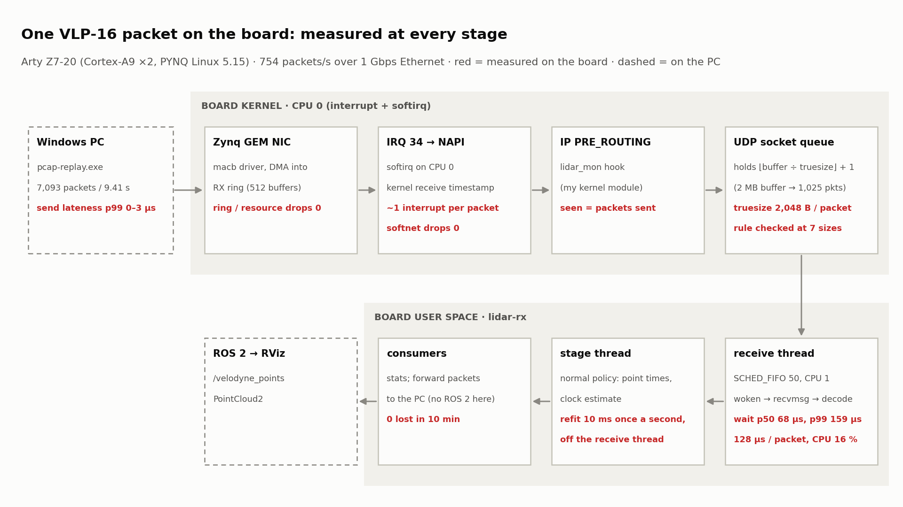

# 수신 경로: NIC에서 lidar-rx까지

- 센서 패킷이 NIC에서 lidar-rx 프레임이 될 때까지 단계별 정리: 복사, 버려지는 곳, 확인 방법
- 커널 쪽은 WSL 커널 6.18 소스로 확인, 보드 커널(5.15 또는 6.6)과 다른 곳은 따로 표시
- 측정값 출처: [experiments.md](modules/experiments.md), [kmod.md](modules/kmod.md)

## 1. 한 장 그림

```text
 실제 NIC (보드, 5단계)                                   loopback (WSL, 지금까지의 측정)
 ──────────────────────                                   ──────────────────────────────
 선 → NIC가 DMA로 rx 링의 버퍼에 씀 (CPU 안 씀)           pcap-replay: sendto()  사용자 → 커널 복사, skb 생성
   │ 인터럽트: "일이 생겼다"만 알림                         │ IP 송신 → loopback_xmit → __netif_rx
   ▼                                                        │ ◆ 커널 수신 시각 (backlog에 넣기 전)
 NAPI poll (softirq): 링에서 꺼내 skb로 스택에 넘김         ▼
   │ ◆ 커널 수신 시각 (스택에 넘기는 순간)                CPU별 backlog 큐 (최대 1000개) → softirq가 꺼냄
   │                                                        │
 ──┴──────────── 여기서부터 같은 길 ────────────────────────┴──────────────────────────────────────
   ▼
 ip_rcv            IP 헤더 검사
   │ PRE_ROUTING 훅 ◄── lidar_mon (맨 앞 NF_IP_PRI_FIRST): 포트 2368·1206 B면 세고 손실 판정, 항상 통과
 라우팅            로컬 주소 대상 여부
 ip_local_deliver  LOCAL_IN 훅
 udp_rcv           받을 소켓 찾기
   │ 버퍼 회계 (truesize) → 넘치면 버림
 소켓 수신 큐 ── sk_data_ready: poll에서 자는 수신 스레드를 깨움
 ═════════════════════════════════ 사용자 공간 ═════════════════════════════════
 lidar-rx 수신 스레드  poll(0.5 s) → recvmsg(MSG_DONTWAIT)  커널 → 사용자 복사 + 제어 메시지(수신 시각, 누적 드롭)
   → 해석 → 프레임 조립 → 소비자마다 채널(try_send) → 소비자 스레드
```

◆ 커널 수신 시각(`SO_TIMESTAMPNS`)은 패킷이 스택에 들어오는 첫 지점에서 찍힌다 (기본값
`net.core.netdev_tstamp_prequeue = 1`). 실제 NIC는 NAPI가 스택에 넘길 때(`netif_receive_skb` 계열), loopback은
backlog 큐에 넣기 전(`netif_rx_internal`)이다. 그래서 WSL에서 잰 큐 대기 시간에는 소켓 큐에서 기다린 시간 말고도
backlog 대기와 IP·UDP 처리 시간이 들어 있다.

인터럽트부터 소켓 큐에 넣기까지는 softirq 문맥이다. 잠들 수 없고, 보통 인터럽트 처리 직후 그 CPU에서 바로
돈다 (일이 너무 밀리면 커널 스레드 `ksoftirqd`가 이어받는데, 이것은 일반 정책 스레드라 실시간 스레드에 밀릴 수 있다).
recvmsg부터는 lidar-rx 수신 스레드의 프로세스 문맥이다. lidar_mon의 훅이 softirq에서 돌고 `/proc` 읽기가
프로세스 문맥이라 잠금을 다르게 쓰는 이유가 이 경계다 ([kmod.md](modules/kmod.md)).

## 2. 단계별: 복사 · 버림 · 확인

| 단계 | 복사 | 버려지는 경우 | 확인 방법 | 이 프로젝트 |
|---|---|---|---|---|
| ① NIC → rx 링 | NIC가 메모리에 직접 씀 (DMA, CPU 복사 없음) | 링에 빈 버퍼가 없음(softirq가 못 따라감), 프레임 오류 | `ethtool -S eth0` (항목 이름은 드라이버마다 다름), `ip -s link` | 보드에서. loopback에는 없는 단계 |
| ② 인터럽트 → NAPI poll | - | 한 번에 처리할 예산(`netdev_budget` 300개 또는 2틱)을 다 써서 다음으로 미룸. 그동안 링이 차면 ①에서 버려짐 | `/proc/net/softnet_stat` 3열 (time_squeeze) | 보드에서 |
| ③ skb 만들기 | Zynq의 GEM 드라이버(`macb`)는 미리 할당한 skb의 데이터 칸에 DMA로 바로 받음 → 복사 없음 (`gem_rx`, 6.18 소스) | 새 버퍼를 못 채움 (메모리 부족) | `ethtool -S` | 보드 커널 소스로 다시 확인 |
| ③′ loopback: backlog | 복사 없음: 송신 때 만든 skb가 그대로 넘어옴 | backlog가 1000개 넘음 (`netdev_max_backlog`, 이유 `CPU_BACKLOG`) | `/proc/net/softnet_stat` 2열 (dropped) | 모듈이 본 수 = 보낸 7,093개 → 여기서 잃은 것 없음 |
| ④ 커널 수신 시각 (loopback은 ③′ 전) | - | - | `SO_TIMESTAMPNS` 제어 메시지 | 큐 대기 시간(실험 2·4)의 시작점, 시계 추정의 호스트 시각 |
| ⑤ IP 수신, PRE_ROUTING | - | 헤더 오류, 방화벽 규칙 | `/proc/net/snmp`의 `Ip:` 줄, `nft list ruleset` 카운터 | **lidar_mon이 여기 맨 앞에서 셈** = "IP 계층에 도착했다" |
| ⑥ 라우팅, LOCAL_IN | - | 로컬 주소 아님, LOCAL_IN 방화벽 | `/proc/net/snmp` | - |
| ⑦ UDP: 소켓 찾기 | - | 받을 소켓 없음 → ICMP port unreachable (이유 `NO_SOCKET`) | `/proc/net/snmp`의 `Udp: NoPorts`, `skb:kfree_skb` | lidar-rx가 재시작하는 동안 오는 패킷이 여기서 버려짐. 모듈은 계속 셈 |
| ⑧ 소켓 수신 큐에 넣기 | - | **버퍼 초과** (truesize로 셈, 이유 `SOCKET_RCVBUFF`) | `SO_RXQ_OVFL`(이 소켓 누적), `/proc/net/udp`의 drops 열, `Udp: RcvbufErrors`(시스템 전체), `udp:udp_fail_queue_rcv_skb`, `skb:kfree_skb` | 실험 1: 용량 = ⌊버퍼 ÷ 2304⌋, 버린 수 네 군데 일치 |
| ⑨ 깨우기 → 스케줄링 | - | 버림은 아님. 늦게 깨면 큐가 차서 ⑧에서 버려짐 | lidar-rx의 큐 대기 히스토그램, `sched:sched_wakeup`·`sched_switch` | 실험 4: 같은 CPU에 부하면 p99 약 5 ms, 수신 스레드만 SCHED_FIFO로 31 ~ 38 µs |
| ⑩ recvmsg | **커널 → 사용자 복사** (1206 B) + 제어 메시지 | 체크섬을 아직 안 봤으면 복사하면서 검사. 틀리면 버리고 다음 패킷을 기다림 (`Udp: InCsumErrors`, 이유 `UDP_CSUM`) | `/proc/net/snmp` | 그래서 poll 뒤에도 큐가 빌 수 있어 `MSG_DONTWAIT`로 읽는다 ([lidar-io.md](modules/lidar-io.md)) |
| ⑪ lidar-rx 안 | 받은 버퍼 → `Packet` 페이로드로 한 번 더 복사 (돌려받은 배열에). 프레임은 `Arc`로 소비자들이 공유 (복사 없음) | **채널이 차면 새로 온 프레임 단위로 버림** (lidar-rx 정책) | 상태 줄·요약의 `queue-drops` | 실험 3 |

## 3. 복사 횟수

```text
 실제 NIC   NIC ─DMA─► 커널 메모리 (CPU 안 씀) ──recvmsg 복사 1번──► 사용자
 loopback   사용자 ──sendto 복사 1번──► skb (커널 안에서는 그대로 넘어감) ──recvmsg 복사 1번──► 사용자
 lidar-rx   수신 버퍼 ──복사──► Packet 페이로드 (1206 B, 돌려받은 배열)    프레임 → 소비자: Arc 공유, 복사 없음
```

- 일반 소켓은 커널에서 사용자 공간으로 반드시 한 번 복사한다. 이것을 없애려면 NIC가 사용자 공간과 공유하는 메모리에
  바로 쓰게 하는 방식(AF_XDP의 제로 카피 모드)이 필요하다. 754 pkt/s × 1206 B ≈ 0.9 MB/s라 이 프로젝트에서는 필요 없다.
- lidar-rx 안의 페이로드 복사(1206 B)도 같은 이유로 남겨 둠. 대신 복사받는 배열은 다 쓴 것을 돌려받아 재사용
  (수신 스레드에서 패킷마다 할당하지 않게, [modules/rx.md](modules/rx.md) "다 쓴 배열 돌려받기")

## 4. 데이터가 기다리는 곳

| 위치 | 양 | 근거 |
|---|---|---|
| rx 링 → softirq | 인터럽트 합치기 설정에 따라 다름 (`ethtool -c`) | 보드에서 |
| 소켓 수신 큐 | 평소 p50 31 µs, p99 58 µs (loopback의 backlog·IP·UDP 처리 포함). 1초 멈추면 가장 오래 기다린 패킷 998 ms | 실험 2 |
| 소켓 수신 큐 (가득) | 큐에 N개 = 가장 앞은 N / 754 초 전 데이터. 커널이 잡은 버퍼 1 MB(요청 512 KB, 455개)면 약 0.6초 | 실험 1·2 |
| 소비자 채널 | 처리가 주기보다 길면 길이 4: 549 ~ 598 ms 전 데이터, 길이 1: 150 ms | 실험 3 |
| 스케줄링 | 같은 CPU 부하 + 일반 정책 p99 4.9 ~ 5.6 ms, SCHED_FIFO 31 ~ 38 µs | 실험 4 |

버퍼는 손실을 지연으로 바꿀 뿐이다. 큰 버퍼는 일시적인 멈춤을 흡수하지만, 처리가 계속 느리면 결국 넘치고 그동안
데이터는 점점 오래된다.

## 5. 손실 위치를 가르는 법

```text
 NIC ─► rx 링 ─► NAPI ─► IP ─► [lidar_mon] ─► UDP ─► 소켓 수신 큐 ─► lidar-rx ─► 채널
   │       │        │              │                      │                            │
 ethtool -S     softnet_stat    모듈의 lost:           SO_RXQ_OVFL · drops 열 ·      queue-drops
 (링 넘침)      (예산·backlog)   센서 타임스탬프 빈틈    RcvbufErrors · kfree_skb 이유
                                = IP 계층 이전 손실
```

| 모듈 계수 | lidar-rx 수신 | 손실 위치 | 세부 확인 |
|---|---|---|---|
| 못 봄 (모듈의 `lost`) | 못 받음 | IP 계층 **이전**: 선, NIC, 링, 드라이버 | `ethtool -S`, `softnet_stat` |
| 봄 | 못 받음 (`seen − 받은 수`) | IP 계층 **이후** | `SO_RXQ_OVFL`과 같으면 전부 버퍼 초과. 다르면 `kfree_skb`의 이유로 (소켓 없음, 체크섬, 방화벽) |

- 사용자 공간만으로도 (센서 타임스탬프로 센 손실) − (`SO_RXQ_OVFL`) = 소켓에 들어오기 전 손실까지는 구할 수 있다.
  모듈이 더하는 것은 그 앞부분을 IP 계층에서 한 번 더 가르는 중간 관측점과, lidar-rx가 없는 동안(재시작 중)에도
  세는 것이다.
- 실험 1에서 ① 모듈 − 받은 수 = ② `SO_RXQ_OVFL` = ③ `kfree_skb`(SOCKET_RCVBUFF) = ④ `udp_fail_queue_rcv_skb`가
  일곱 크기 모두에서 같았다. 서로 다른 층이 같은 사건을 같은 수로 셌다는 것이 이 측정을 믿는 근거다.

## 6. WSL에서 못 본 것 → 보드에서 본 것 (2026-11-11, [5-board.md](runs/5-board.md))



- NIC: Zynq GEM(`macb` 드라이버, rev 0x00020118), PHY RTL8211E, RX 링 512 (최대 8192). 인터럽트 합치기 설정이 없고
  (`ethtool -c` 미지원) 거의 패킷마다 인터럽트가 온다. 실험 동안 `ethtool -S`의 링·자원 부족 드롭(`rx_resource_errors`,
  `rx_overruns`, `q0_rx_dropped`)과 `softnet_stat`의 드롭은 0이었다 (실행마다 앞뒤 차이를 기록).
- truesize: 보드 NIC 드라이버가 만든 skb는 2,048 B (WSL loopback은 2,304 B). 큐가 찼을 때 `/proc/net/udp`의
  rx_queue가 정확히 "큐에 있던 수 × 2048"이었다.
- 판정식: 5.15는 `쌓인 양 > 버퍼`면 버리고, 아니면 더한 뒤 `> 버퍼 + 이번 패킷`일 때만 버린다 → 용량
  ⌊버퍼 ÷ truesize⌋ + 1. 6.18 소스를 읽고 한 예측대로 대부분의 크기에서 하나 더 들어갔다 (실험 1, [experiments.md](modules/experiments.md)).
- UDP의 메모리 반환 미루기: 읽은 패킷의 메모리를 reader 큐가 빌 때까지(또는 버퍼의 1/4이 찰 때까지) 모아서 돌려준다
  (`udp_rmem_release`). 보드처럼 꺼내는 쪽이 느리면 다시 읽기 시작한 직후에도 한동안 "가득 참"으로 보여 더 버리고,
  쉬기 직전에 읽고 아직 안 돌려준 패킷이 있으면 용량이 하나 줄어 보인다. WSL에서는 꺼내는 속도가 빨라 보이지 않았다.
- 체크섬: rx-checksumming on. 하드웨어가 검사하면 `CHECKSUM_UNNECESSARY`로 넘겨 ⑩에서 다시 검사하지 않는다.
- 인터럽트 코어와 수신 스레드 코어: eth0 인터럽트는 실제로 CPU 0만 받고(`effective_affinity` 0, irqbalance 없음),
  수신 스레드는 CPU 1에 둔다. 인터럽트를 받은 CPU 0에서 softirq(lidar_mon 훅, 소켓 큐 넣기)까지 돌고 수신 스레드는
  CPU 1에서 깨어난다 (실험 4에서 부하를 CPU 0·1에 각각 걸어 비교).
- 추적 도구: 보드 커널은 ftrace·tracepoint·kprobes가 꺼져 있다. 그래서 ⑧의 `skb:kfree_skb`·`udp_fail_queue_rcv_skb`
  대신 모듈, `SO_RXQ_OVFL`, `/proc/net/udp` drops, `/proc/net/snmp` RcvbufErrors로 대조했다 (모든 크기에서 같은 수).
- 보드에서 드러난 수신 스레드 쪽 비용: 프레임 조립·시계 다시 맞추기가 PC에서는 1 ms 미만, 보드에서는 7 ms·20 ms라
  큐 대기 p99가 6~7 ms였다. 수신 스레드에서 빼고, 포인트마다 부르던 삼각함수도 없애 p99 0.27 ms (`--forward` 없이 0.16 ms)
  ([5-board.md](runs/5-board.md) 7절). 보드에서 평소 큐 대기 p50은 약 70 µs (WSL 31 µs).
