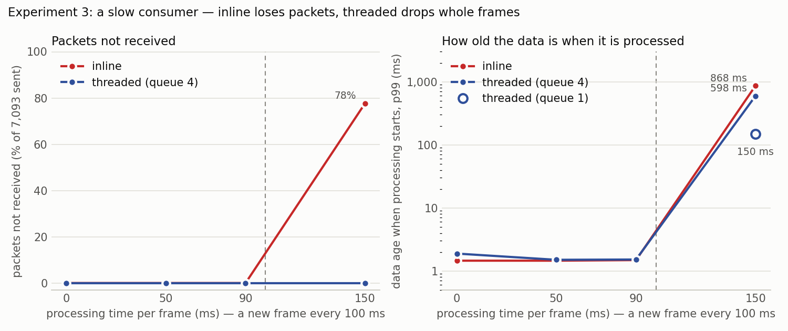
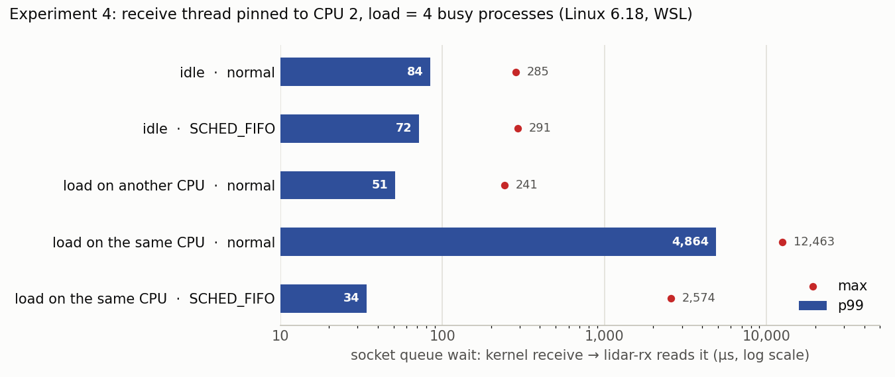

## 실험 3 - 버리는 위치 (inline vs threaded)

lidar-rx에 프레임마다 D ms 동안 CPU를 쓰는 소비자(--work-ms D, 뒤따르는 인식 알고리즘 모사)를 붙이고 7,093 패킷을 받는다. inline은 수신 스레드가 소비자를 직접 부르고, threaded는 소비자가 자기 스레드와 길이 N 채널을 가진다. 프레임은 100 ms마다 하나.

표의 열: received lidar-rx가 실제로 꺼낸 패킷(보낸 7,093개 중), missing 받은 패킷 사이의 빈틈으로 판정한 손실(끝날 때 큐에 남아 못 읽은 패킷은 안 들어감), kdrops 그중 소켓 버퍼가 넘쳐 커널이 버린 수, wait_p99_ms 패킷이 소켓 큐에서 기다린 시간(p99), frames 소비자가 처리한 프레임, complete 그중 온전한 한 바퀴(0°에서 0°까지, 빠진 패킷 없음 - 처음과 끝 조각 2개는 어느 행에서나 빠짐), qdrops 채널이 차서 버린 프레임, age_p99_ms 처리를 시작할 때 그 프레임 데이터의 나이(p99).

```console
$ tools/exp3_inline_threaded.sh
mode      queue work_ms | received missing kdrops wait_p99_ms | frames complete qdrops age_p99_ms
inline        -       0 |     7093       0      0         0.1 |     96       94      0        1.5
inline        -      50 |     7093       0      0        48.6 |     96       94      0        1.5
inline        -      90 |     7093       0      0        88.1 |     96       94      0        1.5
inline        -     150 |     1582    5469   5469       876.5 |     68        1      0      868.4
threaded      4       0 |     7093       0      0         0.1 |     96       94      0        1.9
threaded      4      50 |     7093       0      0         0.1 |     96       94      0        1.5
threaded      4      90 |     7093       0      0         0.1 |     96       94      0        1.5
threaded      4     150 |     7093       0      0         0.1 |     68       66     28      598.0
threaded      1     150 |     7093       0      0         0.1 |     65       63     31      149.5
saved: docs/media/exp3_inline_threaded.csv
```

처리가 프레임 주기(100 ms)보다 짧으면 inline도 손실이 없다 - 소켓 버퍼(기본 212,992 B = 92 패킷 ≈ 122 ms)가 멈춘 동안을 받아 준다. 대신 패킷이 커널에서 처리 시간만큼 기다린다(wait_p99). 처리가 주기보다 길면 inline은 버퍼가 늘 차 있어 커널이 아무 패킷이나 버리고, 한 번 처리하는 동안 반 바퀴 넘게 빠져 처리한 프레임 중 온전한 한 바퀴가 거의 없다. threaded는 패킷을 하나도 잃지 않고, 따라갈 수 없는 만큼 프레임 단위로 버린다. 채널이 길면(4) 처리하는 데이터가 오래되고(약 4 × D), 1이면 약 D.

## 실험 4 - 부하 속 수신 지연 (스케줄링 정책)

수신 스레드를 CPU 2에 고정하고(--cpu 2), replay는 CPU 6에서 보낸다. 부하는 CPU를 쉬지 않고 쓰는 프로세스 4개(bash 무한 루프)를 수신 스레드와 같은 CPU(same) 또는 다른 CPU(other)에 둔다. 정책은 일반(SCHED_OTHER)과 SCHED_FIFO 50(--rt-prio 50, 수신 스레드 하나에만). 큐 대기 시간 = 커널이 받은 시각 → lidar-rx가 꺼낸 시각.

```console
$ sudo tools/exp4_sched.sh
load  policy      |   p50_us   p99_us   max_us | missing kdrops | receive thread (read back)
none  other       |       31       84      285 |       0      0 | SCHED_OTHER, CPUs 2
none  fifo        |       30       72      291 |       0      0 | SCHED_FIFO priority 50, CPUs 2
same  other       |       16     4864    12463 |       0      0 | SCHED_OTHER, CPUs 2
same  fifo        |       14       34     2574 |       0      0 | SCHED_FIFO priority 50, CPUs 2
other other       |       32       51      241 |       0      0 | SCHED_OTHER, CPUs 2
saved: docs/media/exp4_sched.csv
```

같은 CPU에 부하가 있으면 일반 정책에서는 깨어난 수신 스레드가 차례를 기다려 꼬리(p99·최대)가 수 ms로 늘어난다. SCHED_FIFO는 깨어나는 즉시 일반 작업에게서 CPU를 빼앗으므로 p99가 µs로 돌아온다. 최대값은 실행마다 크게 달라 가끔 ms까지 튄다 (여러 번 돌린 값은 docs/modules/experiments.md): WSL에서는 가상 CPU 자체가 Windows 쪽 사정으로 잠깐 멈추고(재검에서 측정으로 확인), 이것은 리눅스 안의 스케줄링 정책으로 막을 수 없다 (최대값은 실제 CPU인 보드에서 다시 잴 것). 다른 CPU의 부하는 영향이 없다. 중앙값은 부하가 있을 때 오히려 작다: 쉬고 있는 CPU를 깨우는 데 시간이 더 드는 것으로 보인다. 소켓 버퍼(약 122 ms)가 지연보다 훨씬 커서 손실은 어느 조건에서도 없다 - 꼬리 지연은 손실이 아니라 데이터의 나이로 나타난다.





_기록한 날: 2026-11-10 12:43, 커널 6.18.54.1-microsoft-standard-WSL2_
