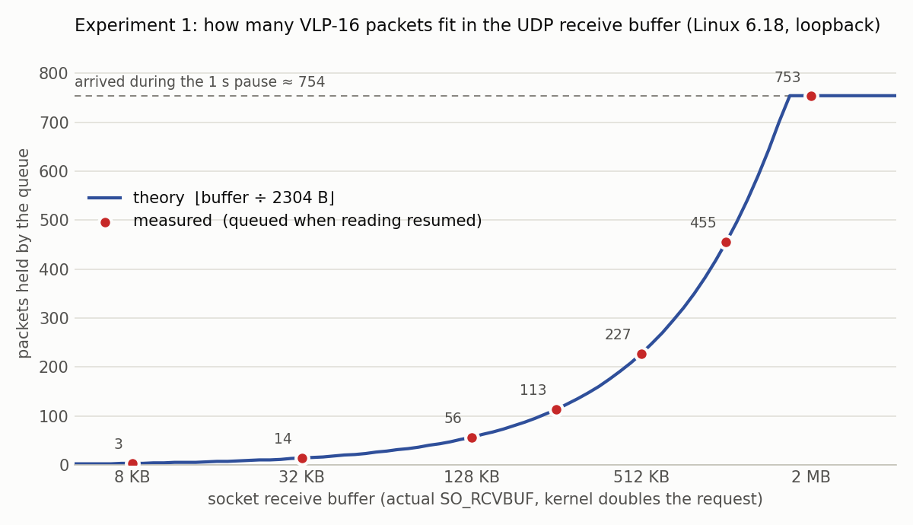

## 모듈 빌드

0단계에서 만든 커널 트리로 빌드한다. W=1: 추가 경고까지 켬 → 경고 없음.

```console
$ make -C kmod 2>&1 | grep -vE "^make"
  CC [M]  lidar_mon.o
  MODPOST Module.symvers
  CC [M]  lidar_mon.mod.o
  CC [M]  .module-common.o
  LD [M]  lidar_mon.ko
  BTF [M] lidar_mon.ko
```

```console
$ /sbin/modinfo kmod/lidar_mon.ko | grep -E "^(description|parm|vermagic)"
description:    Count VLP-16 LiDAR packets at the IPv4 layer and detect loss from sensor timestamps
vermagic:       6.18.54.1-microsoft-standard-WSL2 SMP preempt mod_unload modversions 
parm:           port:UDP destination port of the LiDAR data packets (default 2368) (ushort)
```

## 적재

```console
$ sudo insmod kmod/lidar_mon.ko
```

```console
$ sudo dmesg | grep lidar_mon | tail -n 1
[44418.601097] lidar_mon: watching UDP port 2368 at IPv4 PRE_ROUTING
```

```console
$ cat /proc/lidar_mon
port 2368
seen 0
lost 0
reordered 0
restarts 0
malformed 0
fragments 0
last_timestamp_us 0
last_arrival_ns 0
```

## 패킷을 보내고 세 군데서 세기

replay가 7,093개를 보내는 동안 lidar-rx가 받는다. lidar-rx는 /proc/lidar_mon을 시작·끝에 읽어 IP 계층에서 본 수와 자기가 받은 수를 나란히 보여 준다.

```console
$ target/release/lidar-rx --udp 127.0.0.1:2368 --duration 11 --status 100 2>&1 | grep -E "^(decoder|socket|queue wait|kernel module)" & sleep 0.5; target/release/pcap-replay data/vlp16.pcap --pace sensor 2>&1 | grep sent; wait
pcap-replay: sent 7093 packets in 9.412 s (planned 9.412 s); lateness p50 0 us, p99 11 us, max 459 us, >100 us: 16
decoder: 7093 packets, 96 frames, malformed 0, product-id mismatches 7093, missing 0, reordered 0, restarts 0
socket: kernel drops (SO_RXQ_OVFL) 0
queue wait (kernel receive → read here): p50 31 us, p99 58 us, max 283 us over 7093 packets
kernel module (IP layer, /proc/lidar_mon): seen 7093, lost 0, reordered 0, restarts 0; seen − received here = 0
```

```console
$ cat /proc/lidar_mon
port 2368
seen 7093
lost 0
reordered 0
restarts 0
malformed 0
fragments 0
last_timestamp_us 268471207
last_arrival_ns 1794197699577840810
```

보낸 수 = 모듈이 본 수 = 받은 수, 손실·순서 바뀜·재시작 0. queue wait: 커널이 받은 뒤 lidar-rx가 꺼내기까지 기다린 시간.

## 실험 1, 2 - 소켓 수신 버퍼 용량과 대기 시간

수신 버퍼 크기마다 lidar-rx가 1500개를 받은 뒤 1초 동안 읽지 않는다. 그동안 도착한 약 754개 중 버퍼에 들어간 만큼만 남는다. 버린 수, 네 군데에서 계수: ① 모듈이 본 수 − 받은 수 ② SO_RXQ_OVFL ③ kfree_skb 트레이스포인트(reason SOCKET_RCVBUFF) ④ udp_fail_queue_rcv_skb 트레이스포인트.

표의 열: request_B 요청한 버퍼, actual_B 커널이 잡은 버퍼(요청의 두 배), queued 다시 읽을 때 큐에 있던 수(측정한 용량), theory 이론 용량 ⌊actual_B ÷ 2304⌋ (쉬는 동안 도착한 수가 상한), oldest_ms 가장 오래 기다린 패킷, arrived 쉬는 동안 도착한 수, 그 뒤 ①~④ 버린 수.

```console
$ sudo tools/exp1_rcvbuf.sh 1000
request_B  actual_B     queued   theory  oldest_ms  arrived |     1:kmod     2:ovfl    3:kfree  4:udpfail
4096       8192              3        3        998      753 |        750        750        750        750
16384      32768            14       14        998      753 |        739        739        739        739
65536      131072           56       56        998      753 |        697        697        697        697
131072     262144          113      113        998      753 |        640        640        640        640
262144     524288          227      227        998      754 |        527        527        527        527
524288     1048576         455      455        998      754 |        299        299        299        299
1048576    2097152         753      753        998      753 |          0          0          0          0
saved: docs/media/exp1_rcvbuf.csv
```

①~④가 모든 행에서 같고, 측정한 큐 용량이 모든 행에서 이론값과 같다 - 커널 6.18의 판정식(쌓인 양 + 이번 패킷 > 버퍼면 버림), truesize 2304 B = 2 KB 데이터 칸 + struct sk_buff 256 B. 마지막 행은 버퍼가 쉬는 동안 도착한 수보다 커서 도착한 수(753)에서 막힌다. 가장 오래 기다린 패킷은 약 1초(쉰 시간): 버퍼는 손실을 지연으로 바꿀 뿐이다.



## 해제

```console
$ sudo rmmod lidar_mon
```

```console
$ sudo dmesg | grep lidar_mon | tail -n 1
[44511.299324] lidar_mon: unloaded
```

_기록한 날: 2026-11-09 13:16, 커널 6.18.54.1-microsoft-standard-WSL2_
