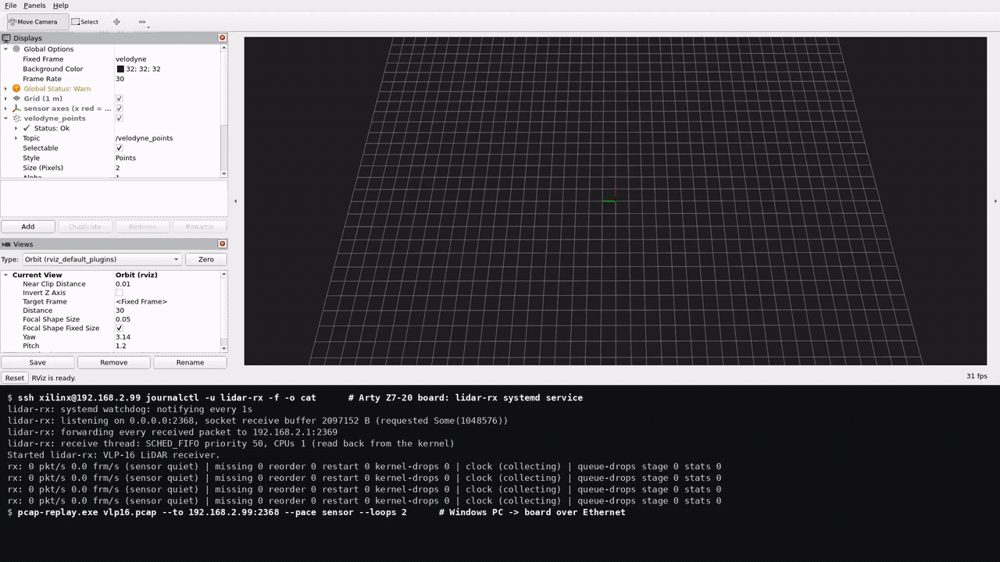
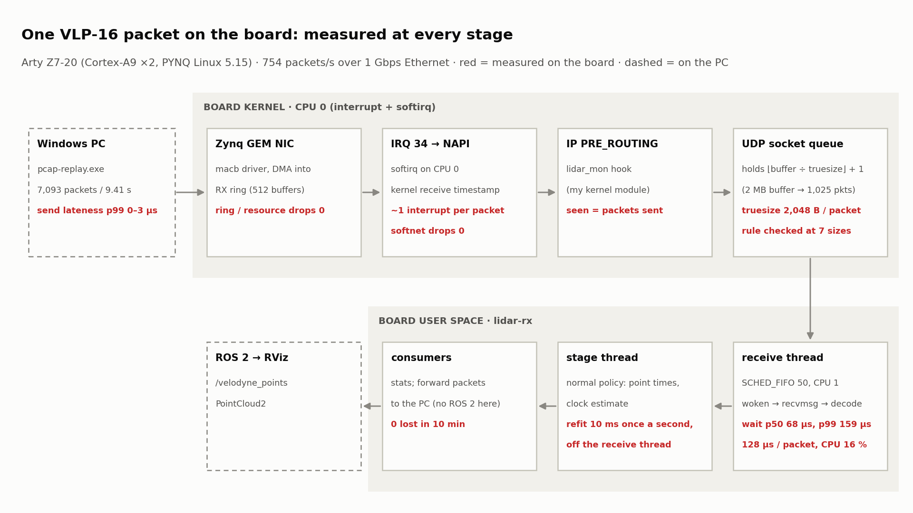
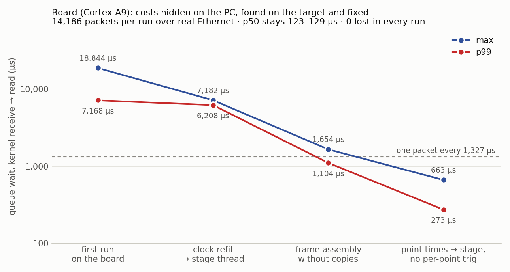
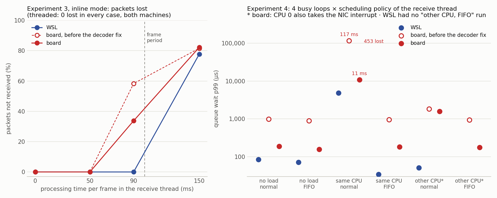
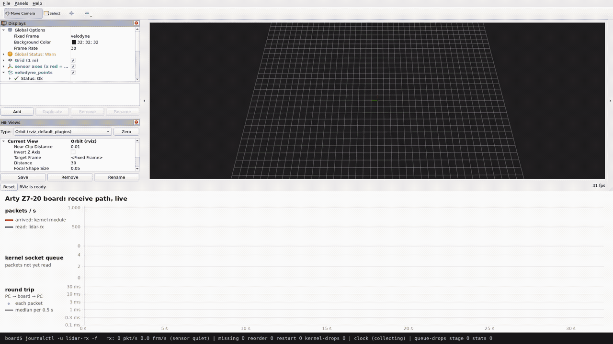

# 5단계 - 실제 보드 (Arty Z7-20)에서

2026-11-11에 실제로 실행한 명령과 출력이다. 보드 시리얼 콘솔과 ssh에서 받은 출력을 그대로 옮겼다 (원본: [5-board_boot.log](5-board_boot.log), [5-board_info.txt](5-board_info.txt),
데모 영상의 터미널 [board_demo_console.tsv](../media/board_demo_console.tsv)).



원본 영상(1920×1080, 35초): [board_demo.mp4](../media/board_demo.mp4)

보드가 받는 과정을 실시간 그래프와 패킷마다 왕복 시간으로 보는 영상은 [11절](#11-실시간으로-보기-보드-수신-경로-그래프와-왕복-시간).



```text
 Windows  pcap-replay.exe ──Ethernet 1 Gbps──► Arty Z7-20 (Cortex-A9 ×2, PYNQ Linux 5.15)
                                                 lidar_mon (IP 계층에서 셈)
                                                 lidar-rx 서비스: 수신 스레드 SCHED_FIFO 50 / CPU 1
                                                 --forward ──► Windows pcap-replay --echo-relay ──► WSL lidar-rx --ros2 ──► RViz
```

## 1. 보드 준비

| 항목 | 값 | 확인 |
|---|---|---|
| 보드 | Digilent Arty Z7-**20** (`xc7z020`) | JTAG(`xsct`)로 읽은 칩 ID |
| 이미지 | PYNQ-Z1 v3.0.1 (PynqLinux 3.0, Ubuntu 22.04, 커널 5.15.19-xilinx-v2022.1) | v3.1.1(8.33 GB)은 8 GB 카드(7.90 GB)에 안 들어감 - zip 끝의 디렉터리만 받아 압축 전 크기를 미리 확인 |
| 부팅 모드 | JP4 = SD | `BOOT_MODE` 레지스터: JTAG 위치일 때 0, SD로 옮긴 뒤 5 |
| 연결 | USB 하나(전원 + UART + JTAG), Ethernet은 USB 어댑터로 PC와 직접 | PC 192.168.2.1, 보드 192.168.2.99 (PYNQ 기본) |

UART는 FTDI 두 번째 채널이라 Windows 장치 관리자에서 "USB Serial Converter B → VCP 드라이버 설치"를 켜야 COM 포트가 생긴다
(A는 JTAG, 건드리지 않음).

## 2. 부팅 흐름 (시리얼 콘솔, [5-board_boot.log](5-board_boot.log))

```text
 BootROM        JP4 → SD. 출력 없음
 FSBL           BOOT.BIN (1.09 MB) 안. PYNQ의 FSBL은 출력 없음. BOOT.BIN에 비트스트림은 없다 (7z020 비트스트림 ≈ 4 MB)
 U-Boot 2022.01 "Loading Environment from FAT... bad env area, using default environment"
                mmc 0:1에서 /boot.scr (2,776 B) 실행
                image.ub (6,464,304 B, 366 ms) = FIT: kernel-0 6.1 MiB + fdt-0 19.3 KiB, 둘 다 sha1 검사 OK
 Linux 5.15.19  root=/dev/mmcblk0p2 (SD 두 번째 파티션, ext4), 512 MiB 중 CMA 128 MiB
                macb e000b000.ethernet: Cadence GEM rev 0x00020118, PHY RTL8211E (rgmii-id)
 systemd 249    multi-user.target 29.3 s (networking.service가 링크를 16 s 기다림), 전체 1 min 24 s
                serial-getty@ttyPS0 자동 로그인 (xilinx), 끝에 /boot/boot.py가 base overlay를 PL에 올림 → DONE LED, LED 깜박임
```

device tree의 `ethernet@e000b000` (`compatible = "cdns,zynq-gem", "cdns,gem"`, `status = "okay"`)가 `macb` 드라이버에
짝지어진 것: `/sys/bus/platform/drivers/macb/e000b000.ethernet`, `/sys/class/net/eth0/device/driver → macb`.

## 3. 보드 커널에서 확인한 것 ([5-board_info.txt](5-board_info.txt), `tools/board/board_info.sh`)

| 항목 | 보드 | 이 프로젝트에 주는 뜻 |
|---|---|---|
| `CONFIG_FTRACE`, tracepoint, kprobes | **꺼짐** | WSL에서 쓰던 `skb:kfree_skb`·`udp:udp_fail_queue_rcv_skb` 추적이 보드에서는 안 된다. 손실은 모듈(`/proc/lidar_mon`), `SO_RXQ_OVFL`, `/proc/net/udp`·`snmp` 카운터로 가른다 |
| `CONFIG_HZ` | 100 | NAPI 시간 예산 2틱 = 20 ms |
| `CONFIG_PREEMPT` | y (RT 아님) | |
| `CONFIG_RT_GROUP_SCHED` | y | cgroup에 cpu 컨트롤러가 켜지면 서비스의 SCHED_FIFO가 거부될 수 있다. 지금은 `memory pids`만 켜져 있어 괜찮음 (수신 스레드 SCHED_FIFO 50 / CPU 1을 커널에서 다시 읽어 확인) |
| `CONFIG_MODVERSIONS` / `MODULE_SIG` | y / 꺼짐 | 모듈은 `Module.symvers`까지 맞아야 하고, 서명은 필요 없음 |
| `net.core.rmem_max` | 180,224 | 서비스가 요청하는 1 MB보다 작음 → `install.sh`가 sysctl.d로 1,048,576으로 올림 |
| `netdev_budget` / `netdev_max_backlog` | 300 / 1000 | WSL과 같음 |
| NIC | `macb`, rx-checksumming on, GRO on, RX 링 512 (최대 8192) | 체크섬은 하드웨어가 검사 → `recvmsg`에서 다시 안 함 |
| eth0 인터럽트 | IRQ 34, 실제로는 CPU 0만, irqbalance 없음 | 수신 스레드(CPU 1)와 인터럽트·softirq(CPU 0)가 갈림 |
| 커널 헤더 | `/lib/modules/…/build` 있음, `modpost` 실행 파일만 없음 | 보드에서 빌드 도구부터 만들면 보드에서 모듈 빌드 가능 |

## 4. 커널 모듈을 보드에서 빌드

```text
$ cd /lib/modules/$(uname -r)/build
$ sudo make scripts            # fixdep 등 (2 min 18 s)
$ sudo make modules_prepare    # modpost (31 s)
$ cd ~/lidar_mon && make KDIR=/lib/modules/$(uname -r)/build KCC=gcc      # W=1, 경고 없음 (15 s)
$ modinfo -F vermagic lidar_mon.ko ; modinfo -F vermagic zocl
5.15.19-xilinx-v2022.1 SMP preempt mod_unload modversions ARMv7 p2v8
5.15.19-xilinx-v2022.1 SMP preempt mod_unload modversions ARMv7 p2v8
$ sudo insmod lidar_mon.ko && cat /proc/lidar_mon | head -3 ; sudo dmesg | tail -1
port 2368
seen 0
lost 0
lidar_mon: watching UDP port 2368 at IPv4 PRE_ROUTING
```

보드 gcc(11.2.0)가 보드 커널을 만든 컴파일러와 같은 판이라 보드에서 빌드했다. 만든 `.ko`는 `kmod/board/lidar_mon.ko`로
가져오면 `tools/board/bundle.sh`가 묶음에 넣는다 (`*.ko`는 git에 올리지 않음). 위 과정은 `tools/board/build_kmod.sh` 하나로
다시 할 수 있다 (빌드 도구가 이미 있으면 그 단계는 건너뜀).

## 5. 설치와 실행

```text
(WSL) $ tools/board/bundle.sh && scp target/board/lidar-rx-board.tar.gz xilinx@192.168.2.99:
(보드) $ tar xzf lidar-rx-board.tar.gz && cd lidar-rx-board && sudo deploy/install.sh
== user lidar
== /usr/local/bin/lidar-rx (target/release/lidar-rx), /etc/lidar-rx/
== kernel module lidar_mon (loaded at boot by systemd-modules-load)
== socket receive buffer limit
net.core.rmem_max 180224 -> 1048576
== services
installed. start: sudo systemctl enable --now lidar-rx
```

ROS 2가 없으므로 `install.sh`는 `--ros2`를 뺀 설정을 깔고 녹화 서비스는 깔지 않는다. 실제 하드웨어라 `systemd-modules-load`가
건너뛰지 않고 모듈을 올렸다 (WSL에서는 가상화로 보고 건너뜀). 데모용으로 보드의 `/etc/lidar-rx/lidar-rx.env`를
`--status 2 --forward 192.168.2.1:2369`를 더한 값으로 고쳐 두었다.

데모 녹화용 준비 (한 번):
- 보드 `/etc/sudoers.d/lidar-rx-demo`: `systemctl restart|stop|start lidar-rx` 세 명령만 비밀번호 없이 (`visudo -c`로 확인)
- Windows 방화벽: 192.168.2.0/24 → UDP 2369 들어오는 것 허용 (Windows에서 받아 WSL로 넘김. Windows 10의 WSL2는
  바깥에서 오는 UDP를 직접 받지 못함). 처음에는 PowerShell 스크립트가 넘겼다. 나중에 Windows가 powershell.exe의
  "공용 네트워크" 수신을 막는 규칙을 만들어(방화벽이 처음 묻는 창에서 개인 네트워크만 고르면 생김. 막는 규칙은 포트를 여는
  규칙보다 앞섬, 보드 어댑터는 공용) 0개를 받게 되어, 지금은 `pcap-replay.exe --echo-relay`가 넘긴다

## 6. 결과 - 처음 돌렸을 때 (한 바퀴, 7,093 패킷)

```text
decoder: 7093 packets, 96 frames, malformed 0, product-id mismatches 7093, missing 0, reordered 0, restarts 0
socket: kernel drops (SO_RXQ_OVFL) 0
queue wait (kernel receive → read here): p50 127 us, p99 6400 us, max 12307 us over 7093 packets
kernel module (IP layer, /proc/lidar_mon): seen 7093, lost 0, reordered 0, restarts 1; seen − received here = 0
clock: skew -0.875 ppm (least squares -0.917), …; residual above envelope p50 7.0 us, p99 47.9 us, max 218.1 us
forward: 7093 packets to 192.168.2.1:2369, 0 failed
```

손실 없음, IP 계층에서 본 수 = 받은 수. 그런데 큐 대기 p99가 6.4 ms였다 (WSL 58 µs). 시계 잔차(커널 수신 시각 기준)는
p99 48 µs로 안정적이므로, 늦는 쪽은 네트워크가 아니라 사용자 공간에서 꺼내는 시점이다.

## 7. 보드에서 찾은 실행 비용과 고친 것



같은 코드가 PC에서는 1 ms 미만인 일을 보드에서 재 보니 수신 스레드(실시간 정책)를 수 ms씩 막고 있었다. 실시간 수신
스레드에는 패킷마다 상한이 정해진 일만 남기는 것을 원칙으로 세 가지를 고쳤다.

| 무엇 | 측정 (예제) | PC | 보드 처음 | 고친 것 | 보드 지금 |
|---|---|---|---|---|---|
| 시계 다시 맞추기 (1초마다, 창 30 s = 22,620점) | `refit_cost` | 0.97 ms | **20.94 ms** | 잔차 분위수를 정렬 대신 선택으로 (10.5 ms), 그리고 **수신 스레드 밖(stage 스레드)으로** ([clock.md](../modules/clock.md), [rx.md](../modules/rx.md)) | 수신 쪽 0 |
| 프레임을 내보내는 `decoder.push` (초당 10번) | `push_cost` | 31.5 µs | **7,157 µs** | 점을 처음부터 최종 형태로 모으고 다음 버퍼를 미리 잡음(1.9 ms), 남은 시각 옮기기는 stage로 (`Frame::pending_time_shift`) ([vlp16.md](../modules/vlp16.md)) | **267 µs** |
| 평소 `decoder.push` (패킷 하나 해석) | `push_cost` | 6.7 µs | **212 µs** | 포인트마다 부르던 삼각함수를 없앰 (덧셈 공식, 패킷마다 16 + 24번만) | **128 µs** |

같은 조건(서비스 설정 그대로 `--forward` 포함, 두 바퀴 14,186 패킷, 서비스를 새로 시작해 카운터 0부터)에서 보드의 큐 대기
(`docs/media/board_fix_latency.csv`):

| | 처음 | 시계를 stage로 | 프레임 조립 고침 | **점 시각 → stage, 삼각함수 없앰** |
|---|---|---|---|---|
| p50 | 127 µs | 129 µs | 123 µs | 123 µs |
| p99 | 7,168 µs | 6,208 µs | 1,104 µs | **273 µs** |
| max | 18,844 µs (창이 찰수록 커짐) | 7,182 µs | 1,654 µs | **663 µs** |

- 손실 0, `SO_RXQ_OVFL` 0, 모듈 seen − received = 0은 모든 실행에서 같다.
- 수신 스레드의 CPU 사용 (서비스 조건, 한 바퀴 9.41 s 동안 스레드별 `/proc/<pid>/task/*/stat`): 2.08 s(22%) → 1.52 s(16%).
  stage 0.19 s, 통계 소비자 0.05 s. 이 차이가 실험 4의 결과를 바꿨다 (같은 CPU 부하 + 일반 정책에서 굶던 것이 사라짐,
  [experiments.md](../modules/experiments.md) 보드 절).
- `--forward` 없이 같은 측정을 하면 p50 68 µs, p99 159 µs (PC로 다시 보내는 `sendto`가 수신 스레드에서 패킷마다 돈다).

파일 입력은 버리지 않게: stage 스레드를 두면서 녹화 파일(`--pcap`)처럼 빨리 읽는 입력에서는 stage가 밀릴 수 있다. 파일
입력이면 stage 채널에서 기다리게 했다 (실시간 소켓일 때만 버림). 느린 qemu-arm에서 threaded와 inline 결과가 한 글자도 다르지
않음으로 확인 (x86 결과와도 같음).

고친 뒤에도 결과가 같은가: 테스트 60개 통과 (참조 구현과 포인트 단위로 맞추는 골든 테스트 포함). 해석기를 바꾼 뒤 녹화
파일의 요약(프레임 96개, 프레임당 27,034점, 시계 −53.457 ppm, 잔차 p99 337.4 µs)이 바꾸기 전과 한 글자도 다르지 않다.

## 8. 전원 (USB 하나로 쓸 때)

- 소프트웨어 재부팅(`reboot`)을 두 번 했고, 두 번 다 약 7초마다 리셋이 반복됐다 (COM 포트가 사라졌다 다시 생김). JTAG로 읽은
  `REBOOT_STATUS`의 POR 비트가 1이라 실제로 전원이 떨어진 것이고, 반복 끝에 BootROM이 SD 부팅에 실패한 채(오류 코드 0x200A)
  멈췄다. USB를 뽑았다 꽂는 냉부팅은 매번 정상이었다.
- 그래서 USB 전원으로 쓰는 동안에는 `reboot` 대신 USB를 뽑았다 꽂는다. 안정적으로 쓰려면 외부 전원(DC 7~15 V, JP5를 REG로).

## 9. 전원 재투입 후 부팅만으로 올라오는지 확인

```text
uptime 40.18 s
lidar_mon 16384 0 - Live 0x00000000 (O)                         ← systemd-modules-load가 부팅 때 올림
modules-load: active  lidar-rx: active (enabled)
net.core.rmem_max = 1048576                                      ← /etc/sysctl.d/90-lidar-rx.conf
  242  FF     50   1 lidar-rx                                     ← 수신 스레드만 실시간 정책
  242  TS      -   1 consumer-stats
  242  TS      -   1 stage                                        ← stage·소비자 스레드는 일반 정책 그대로
lidar-rx: receive thread: SCHED_FIFO priority 50, CPUs 1 (read back from the kernel)
Started lidar-rx: VLP-16 LiDAR receiver.
```

### 오래 돌리기와 장애 시험 ([board_service_check.txt](../media/board_service_check.txt))

Windows replay가 끝없이 보내는 동안 서비스(데모 설정, `--forward` 포함)를 30초마다 읽었다:

```text
  30s  pid 11783 rss 1628 kB cpu   7.40 s restarts 0 | rx: 754 pkt/s … kernel-drops 0 wait-p99 275 us | clock -1.00 ppm … p99 51 us
 308s  pid 11783 rss 1692 kB cpu  76.19 s restarts 0 | rx: 754 pkt/s … kernel-drops 0 wait-p99 274 us | clock -1.08 ppm … p99 54 us
 618s  pid 11783 rss 1568 kB cpu 153.36 s restarts 0 | rx: 754 pkt/s … kernel-drops 0 wait-p99 276 us | clock -0.98 ppm … p99 51 us
```

- 10분 동안 손실 0, 재시작 0. 큐 대기 p99 273 ~ 276 µs 그대로 (시계 추정 창이 다 찬 뒤에도). 메모리(RSS)는 1.3 ~ 1.9 MB
  사이를 오르내릴 뿐 늘지 않음 (프레임 배열은 소비자가 다 쓰면 해제됨). CPU는 서비스 전체 약 25% (수신·PC로 넘기기·stage·통계).

```text
== SIGSTOP (수신 루프가 멈춤)
lidar-rx.service: Watchdog timeout (limit 2s)!
lidar-rx.service: Killing process 11783 (lidar-rx) with signal SIGABRT.
lidar-rx.service: Scheduled restart job, restart counter is at 1.
after: pid 13489 … restarts 1 | rx: 754 pkt/s … kernel-drops 0
== SIGKILL (프로세스가 죽음)
lidar-rx.service: Main process exited, code=killed, status=9/KILL
lidar-rx.service: Scheduled restart job, restart counter is at 2.
after: pid 13649 … restarts 2 | rx: 754 pkt/s … kernel-drops 0
```

- WSL 4단계와 같은 동작을 실제 보드에서 확인: 멈춘 루프는 watchdog(2 s)이 잡아 재시작, 죽은 프로세스는 `Restart=on-failure`로
  재시작, 둘 다 몇 초 안에 다시 754 pkt/s. 그동안 커널 모듈은 계속 셌다 (재시작 사이에 온 패킷은 받을 소켓이 없어 커널이 버림).

## 10. 실험 1~4를 보드에서

WSL에서 한 실험 네 개를 보드에서 다시 했다. 결과와 WSL과의 비교는
[experiments.md의 보드 절](../modules/experiments.md#보드에서-2026-11-11-arty-z7-20-실제-ethernet). 요약:



- 실험 1: 패킷 하나가 버퍼를 2,048 B 차지하고(WSL 2,304 B), 용량은 ⌊버퍼 ÷ 2048⌋ + 1 - 6.18 소스를 읽고 한 예측대로
  5.15는 하나 더 담는다. 버린 수는 모듈·`SO_RXQ_OVFL`·`/proc/net/udp`·snmp 네 곳이 모든 크기에서 같다.
- 실험 2: 1초 쉬면 가장 오래 기다린 패킷 999 ms.
- 실험 3: threaded는 WSL과 같은 결과(손실 0, 밀리면 프레임 단위로 버림). inline은 보드에서 해석 비용이 커서 처리 90 ms에서도 잃는다.
- 실험 4: SCHED_FIFO면 어떤 부하에서도 p99 160 ~ 180 µs. 같은 CPU 부하 + 일반 정책에서 해석기를 고치기 전에는 수신 스레드가
  CPU 22%를 써 공평한 몫(20%)을 넘어 굶었고(453개 손실), 고친 뒤(16%) 손실 0.
- NIC 단계(링, 자원, softnet) 드롭은 모든 실행에서 0. 손실은 모두 소켓 버퍼에서 났다.

## 11. 실시간으로 보기: 보드 수신 경로 그래프와 왕복 시간



원본 영상(1920×1080, 32초): [board_live.mp4](../media/board_live.mp4) · 그래프만: [board_live_panel.png](../media/board_live_panel.png) ·
데이터: [board_live_board.csv](../media/board_live_board.csv) (보드, 0.1 s마다),
[board_live_rtt.csv](../media/board_live_rtt.csv) (패킷마다 왕복), [board_live_console.tsv](../media/board_live_console.tsv) (보드 로그),
[board_live_pc.log](../media/board_live_pc.log) (PC 쪽 출력)

```text
 Windows pcap-replay.exe ──► 보드 :2368 ── lidar-rx ── --forward ──► Windows :2369 (pcap-replay --echo)
           보낸 시각 ────────────────── 같은 Windows 시계 ──────────────────── 돌아온 시각   → 패킷마다 왕복 시간
                                                        └ --echo-relay ──► WSL lidar-rx --ros2 ──► RViz
 보드 (0.1 s마다 읽음): 커널 모듈이 본 수, 소켓 큐, 소켓이 버린 수 ──ssh──► WSL ──► 그래프
      lidar-rx가 읽은 수 = 본 수 − 큐에 있는 수 − 버린 수  (2368로 온 패킷은 셋 중 하나)
```

세 바퀴(20,676개)를 보내며 12 s 뒤 0.8 s는 보내지 않았다 (`pcap-replay --gap 12:0.8`, 선을 뽑은 것처럼: 센서는 계속 돌고
그동안의 패킷만 사라짐). 1 s보다 짧게 끊은 이유: 1 s 넘게 끊기면 커널 모듈과 lidar-rx 모두 손실이 아니라 "센서 재시작"으로 본다.

| 본 것 | 결과 |
|---|---|
| 커널 모듈이 본 수 vs lidar-rx가 읽은 수 (0.1 s마다) | 처음부터 끝까지 1개 넘게 벌어진 적 없음 |
| 커널 소켓 큐 | 최대 1개 |
| 끊긴 0.8 s | 도착 0, 읽음 0. 다시 오자 바로 따라옴. 보내지 않은 603 = 커널 모듈 lost 603 = lidar-rx missing 603 |
| 왕복 (PC → 보드 → PC) | 20,676개 모두 돌아옴. 가운데값 0.39 ms, p99 13.4 ms (아래: 꼬리는 보드가 아님) |

두 기기의 시계는 맞추지 않는다. 왕복은 보낸 시각과 돌아온 시각을 모두 Windows 시계로 잰다. 그래프의 가로축은 보드 줄을 WSL이
받은 시각으로 옮기고(가장 빨리 온 줄 기준), Windows의 송신 시작은 보드가 첫 패킷을 받은 시각에 맞춘다.

### 왕복 시간 꼬리의 위치: 보드가 아니라 PC(Windows) 안

p99 13 ~ 14 ms, 최대 수십 ms. 큰 값은 톱니 모양이다: 연속한 패킷의 왕복이 7.06 → 5.74 → 4.41 → 3.09 → 1.76 ms로 패킷 간격
(1.327 ms)만큼씩 줄어든다 = 어딘가에 붙잡혀 있다가 한꺼번에 풀렸다.

**패킷별 여섯 지점 시각으로 구간 분해** (한 실행, 7,093개 모두 짝지음):

```text
 PC 프로그램 송신 ─A→B─ PC NIC 송신 ─B→C─ 보드 커널 도착 ─C→D─ 보드 드라이버에 넘김 ─D→E─ PC NIC 도착 ─E→F─ PC 프로그램 수신
   pcap-replay --echo     Windows pktmon        lidar-rx --forward-tx-log            pktmon               pcap-replay
                          (NIC 단계)            (SO_TIMESTAMPING 송신 시각)          (NIC 단계)
```

| 구간 | p50 | p99 | 최대 | 측정 방법 |
|---|---|---|---|---|
| A→B PC 프로그램 → PC NIC | | 0.03 ms 초과 | 1.2 ms | 다른 시계: 1 s 창의 최소를 뺀 "더 걸린 만큼" |
| B→C PC NIC → 보드 커널 (케이블 포함) | | 0.04 ms 초과 | 1.6 ms | 〃 |
| C→D 보드: 커널 도착 → 드라이버에 넘김 | 0.12 ms | 0.27 ms | 0.77 ms | 같은 보드 시계 |
| D→E 보드 드라이버 → PC NIC (케이블, USB 어댑터) | | 2.3 ms 초과 | 8.0 ms | 다른 시계 |
| **E→F PC NIC → PC 프로그램 (Windows 안)** | | **12.8 ms 초과** | **15.5 ms** | 다른 시계 |
| 왕복, NIC 단계 (B→E) | 0.32 ms | 2.6 ms | 8.3 ms | 같은 Windows 시계 |
| 왕복, 프로그램 단계 (A→F) | 0.37 ms | 13.2 ms | 18.9 ms | 같은 Windows 시계 |

**Windows 안을 구성 요소별로** (pktmon을 모든 구성 요소에, 받는 패킷 7,092개):

| 받는 단계 | p50 | p99 | 최대 |
|---|---|---|---|
| USB 어댑터 드라이버(rtux64w10) → WFP Native 필터 → WFP 802.3 필터 | 0.02 ms | 0.09 ms 이하 | 0.12 ms |
| **WFP 802.3 필터 → TCPIP** | 0.02 ms | **13.3 ms** | **46 ms** |

92%의 패킷이 NIC에서 받은 스레드와 TCPIP가 처리한 스레드가 다르다: 이더넷 프레임 단계 뒤에서 처리가 다른 스레드로 넘어간다.

넘겨받는 스레드 - pktmon이 단계마다 적는 PID.TID와 커널 추적(`logman`의 NT Kernel Logger: 지금 있는 스레드의 시작 주소·
우선순위·허용 CPU, 드라이버 주소 범위)을 맞췄다:

```text
 빠른 패킷:     NIC 단계는 CPU 0의 DPC(쉬던 CPU에 끼어듦, PID 0)  →  TCPIP 단계는 System 스레드 4.480
 붙잡힌 패킷:   NIC 단계 순간 CPU 0이 어떤 프로그램 스레드를 돌리던 중  →  TCPIP 단계는 그 뒤 4.480 (또는 그 스레드에 다시 끼어든 DPC)
 스레드 4.480:  시작 주소 ndis.sys +0x37340, 기본 우선순위 8 (보통 프로그램과 같음), 허용 CPU 0x1 (CPU 0만)
               (같은 코드의 4.484는 CPU 1 전용 → NDIS의 CPU별 작업 스레드)
```

USB 어댑터로 받은 패킷은 전부 CPU 0에서 받고(USB 컨트롤러 인터럽트가 CPU 0), NDIS가 CPU 0 전용·보통 우선순위 작업 스레드로
넘겨 TCP/IP로 보낸다. CPU 0에서 다른 보통 우선순위 스레드가 돌고 있으면 그 작업 스레드는 차례를 기다린다. 이것을 직접
일으켜 봤다 - 보내는 프로그램(pcap-replay)은 정확한 간격을 위해 CPU 하나를 쉬지 않고 쓴다:

| pcap-replay를 둔 CPU | 왕복 p50 | p99 | 최대 |
|---|---|---|---|
| 정하지 않음 | 0.36 ~ 0.37 ms | 13.0 ~ 13.6 ms | 16 ~ 20 ms |
| **CPU 0에만** | **11.8 ~ 13.1 ms** | 28 ms | 31 ~ 36 ms |
| CPU 0 제외 | 0.35 ~ 0.36 ms | 6.6 ~ 11.0 ms | 15 ~ 33 ms |
| **CPU 0에만 + 우선순위 "보통 이하"** | 0.36 ms | **1.8 ms** | 15 ms |
| CPU 0에만 + 우선순위 "유휴" | 0.36 ms | 2.9 ms | 15 ms |
| 정하지 않음 + "보통 이하" | 0.36 ms | 10.5 ms | 20 ms |

CPU 0에 두면 거의 모든 패킷이 기다리고, 빼면 꼬리가 반쯤 준다. 남은 꼬리는 CPU 0을 쓰는 다른 프로그램 몫이다 (붙잡힌 패킷의
NIC 단계 PID가 여러 프로세스). NDIS 작업 스레드 자체의 우선순위는 커널 스레드라 바꿀 수 없지만, 보내는 프로그램을 **CPU 0에
두고 우선순위만 작업 스레드(8)보다 낮추면** p99가 1.8 ms가 된다: 그 프로그램이 CPU 0을 차지하고 있어 다른 보통 우선순위
프로그램은 빈 CPU로 가고, 작업 스레드는 오는 즉시 그 프로그램을 밀어낸다 - CPU 0이 사실상 수신 전용이 된다. 대가로 보내는
프로그램이 밀려나는 만큼 송신 간격이 흔들린다 (늦음 p99 0 → 182 µs, 최대 5 ms). 풀려나는 순간이 타이머 틱(15.625 ms)의 배수가 아닌 것(맞는 비율 13 ~ 19%, 우연 수준 약 10%)도
"타이머로 모았다 내보냄"이 아니라 "다른 스레드가 CPU를 내줄 때까지 기다림"과 맞는다.

AhnLab이 아니다 - 이더넷 프레임 단계(`FWPM_LAYER_INBOUND_MAC_FRAME_ETHERNET`)에 검사 드라이버를 건 외부 프로그램은
AhnLab Safe Transaction(은행 보안 프로그램)의 "AhnLab Network Filtering" 하나뿐이라 먼저 의심했다. 서비스는 정지 요청을 받지
않고(`NOT_STOPPABLE`), 설정에서 "네트워크 침입 차단"을 꺼도 WFP 필터가 남아 있어 그대로였다. 제품을 지운 뒤(WFP의 AhnLab 콜아웃
0개) 다시 쟀다: 붙잡히는 자리(필터 → TCPIP p99 13.1 ms), 넘겨받는 스레드(4.480), CPU 0 실험(p50 11.8 ms) 모두 같았다.

정리: **꼬리는 Windows가 USB 어댑터로 받은 패킷을 CPU 0 전용·보통 우선순위의 NDIS 작업 스레드로 넘기고, 그 스레드가 CPU 0의
다른 스레드 뒤에서 기다리는 데서 생긴다.** 보드·케이블·어댑터 하드웨어·AhnLab이 아니다. NDIS가 왜 이 어댑터의 수신을 작업
스레드로 넘기는지(드라이버가 수신을 알리는 방식)는 보지 못했다. PCIe NIC(인터넷용)로 바꿔 재 보지는 않았다. Windows에서 잴 때는
보내는 프로그램을 CPU 0에서 빼는 것만으로 p99가 약 절반이 된다.

| 그 전에 확인한 것 | 결과 | 뜻 |
|---|---|---|
| 보드 도착 시각의 어긋남 (시계 추정 잔차) | 꼬리가 큰 구간에서도 p99 60 µs | PC → 보드 방향은 제때 |
| 보드 커널 → lidar-rx 대기 | p99 0.28 ms | 보드 안 처리는 짧음 |
| 보드 송신 큐 (`tc -s qdisc`), PAUSE 프레임 (`ethtool -S`) | requeues 0, 버림 0 / 0 | 보드 송신이 밀리지 않음 |
| 보내는 속도를 1/10로 (패킷 간격 13 ms) | p99 9.1 ms (2 ms 넘은 것 7.4%) | 부하 때문이 아님 |
| Windows 타이머를 1 ms로 (`timeBeginPeriod`, 15.6 ms 의심) | p99 13.3 ~ 13.8 ms 그대로 | 타이머 탓 아님 (가설 틀림) |
| Windows 안에서만 되돌림 (127.0.0.1) | p50 76 µs, p99 0.13 ms | 이것만 보고 "Windows 탓 아님"이라 했던 것은 **틀렸다**: 127.0.0.1은 NIC 수신 경로(이더넷 프레임 단계)를 지나지 않는다 |
| ping 200번 | 최대 23 ms | ping 응답도 같은 Windows 수신 경로를 지남 |

원본 ([board_rtt_check/](../media/board_rtt_check/)): `segments_6points.csv` 패킷마다 여섯 지점, `windows_steps.txt` 구성 요소별
표·WFP 콜아웃 목록·스레드 4.480의 정체·CPU 실험 요약, `sender_*.csv` CPU 실험, `ahnlab_off_*.csv` 설정만 끈 때,
`board_gap2s.csv`·`slow_rate_0.1.csv`·`timer_default.csv`·`timer_1ms.csv`·`windows_loopback.csv` (모두 패킷마다 `send_s,rtt_us`).

보드 쪽은 보드 시계로 직접 잰 "커널 도착 → 드라이버에 넘김"이 모든 패킷에서 0.77 ms 이하다 (`lidar-rx --forward-tx-log`,
넘긴 패킷마다 `SO_TIMESTAMPING` 송신 시각). 실제 로봇에서는 센서가 보드 NIC에 바로 붙어 이 PC 구간이 없다. 그래프는 패킷
하나하나를 옅은 점으로, 0.5 s마다의 가운데값을 진한 선으로 그려 꼬리에 가운데값이 묻히지 않게 했다.

### 한 번 본 0.2 s 멈춤과 `--lock-memory`

첫 녹화 때 한 번, lidar-rx가 약 0.2 s 동안 패킷을 읽지 않았다 (보내기 시작 3.3 s쯤):

```text
 0.1 s마다 읽은 값              커널 모듈이 본 수   보드 UDP 송신*    소켓 큐
   0.123 s 동안                       +92             +93            0
   0.214 s 동안                      +161              +7          157   ← 커널은 평소대로 받는데 lidar-rx가 안 읽음
   0.119 s 동안                       +90            +242            0   ← 한꺼번에 따라잡음
 다음 상태 줄: wait-p99 210,944 us (평소 280), kernel-drops 0, 그 198개의 왕복 약 240 ms
 그 프로세스의 수신 스레드: 큰 페이지 폴트(디스크에서 읽어야 하는 폴트) 6번
 * 이때는 lidar-rx가 넘긴 수를 Udp OutDatagrams로 셌다 (아래 "측정 실수"). 큐 157이 직접 증거
```

값을 읽는 쪽(bash)의 간격도 그때만 0.12 → 0.214 s로 늘었다: lidar-rx만이 아니라 보드 전체가 잠깐 막혔다. 그 뒤 20번
돌렸지만 (서비스 새로 시작 + 한 바퀴·세 바퀴, 파일 캐시를 비우고(`drop_caches`), 값 읽기를 켜고·끄고, 아래 `--lock-memory`
비교, 녹화 2번) 다시 나지 않았다: 대기 p99가 0.4 ms를 넘은 적이 없고(`MCL_FUTURE`를 켠 2번은 아래의 다른 이유), 큰 폴트는
0 ~ 1번. 원인은 확정하지 못했다.

확실히 막을 수 있는 것은 수신 스레드가 SD 카드 읽기(큰 페이지 폴트)를 기다리는 일이다. 실시간 리눅스의 표준 방법인
`mlockall`을 `--lock-memory`로 넣고 보드에서 비교했다 (세 바퀴, 두 번씩):

| `--lock-memory` | 대기 p99 | 수신 스레드 작은 폴트 (세 바퀴) | 고정된 메모리 |
|---|---|---|---|
| 없음 | 301, 328 µs | 48,514 | 0 |
| `mlockall(MCL_CURRENT \| MCL_FUTURE)` | **2,032, 2,048 µs** | 71,799 | 6.4 MB |
| `mlockall(MCL_CURRENT)` | 287, 281 µs | 48,505 | 4.9 MB |

교과서대로 앞으로 받을 메모리까지 고정(`MCL_FUTURE`)하면 p99가 7배 나빠졌다. 보드용 실행 파일은 musl(정적 링크)인데, musl은
128 KB 넘는 할당을 매번 `mmap`으로 새로 받고 해제하면 바로 돌려준다. 프레임 버퍼(약 650 KB)가 프레임마다 새로 받아지고,
`MCL_FUTURE`는 받는 순간 160페이지를 전부 채워 넣는다 → 수신 스레드에서 프레임마다 그만큼 멈춤. 그래서 이때는 **지금 있는
메모리만**(`MCL_CURRENT`: 실행 코드 전체, 스택, 힙) 고정했다. p99는 그대로였다.

- 서비스: `LimitMEMLOCK=64M` (기본 8 MB는 스레드 스택만으로 찰 수 있음). 보드 로그:
  `receive thread: SCHED_FIFO priority 50, CPUs 1, memory locked 4976 kB`
- PC(`--ros2`)에서는 끈다: DDS 메모리까지 64 MB를 넘어 `mlockall`이 실패했다 (WSL 실측, `Cannot allocate memory`)
- 켠 뒤 녹화(위 영상): 큐 최대 1, 큰 폴트 0. 다만 멈춤을 다시 일으키지 못했으므로 이것으로 그 멈춤이 고쳐졌다고는 말할 수 없다.
  막은 것은 "디스크를 기다리는 길" 하나다

### 수신 스레드에서 메모리 받기를 없앰 (배열 재사용)

위에서 남은 것: 수신 스레드의 작은 폴트가 초당 약 1,700번이었다 (새로 받은 프레임 버퍼를 처음 쓸 때 페이지마다). 패킷당
수 µs라 p99에는 보이지 않지만, 실시간 스레드가 커널의 메모리 관리(걸리는 시간에 상한이 없는 일)를 프레임마다 부르는
것이고, 그 때문에 `MCL_FUTURE`도 못 썼다. 그래서 다 쓴 배열을 수신 스레드로 돌려보내 다시 쓰게 했다
([rx.md](../modules/rx.md) "다 쓴 배열 돌려받기"). 두 단계로 했다. 프레임 점 배열만 돌려받게 하자 폴트가 1/14로 줄었지만
초당 약 83번이 계속 남았다. strace로 수신 스레드를 보니 16 KB·4 KB `mmap`/`munmap`이 10 s에 193쌍이었다: 패킷마다
받고 놓는 작은 배열 둘(해석한 포인트, 페이로드)을 musl이 묶음째 돌려줬다 다시 받는 것. 그 둘도 다시 쓰게 했다.

세 바퀴(28 s, 21,279 패킷), 순서를 섞어 두 번씩, 보드 서비스 그대로:

| | 대기 p99 | 수신 스레드 작은 폴트 | 수신 스레드 CPU | 고정된 메모리 |
|---|---|---|---|---|
| 재사용 전, `MCL_CURRENT` | 303, 368 µs | 48,504 | 20.7 % | 4.9 MB |
| 재사용 후, `MCL_CURRENT` | 277, 273 µs | 396 | 17.1 % | 5.0 MB |
| 재사용 후, `MCL_CURRENT \| MCL_FUTURE` | 281, 274 µs | 556 | 17.1 % | 7.7 MB |
| 재사용 후, 고정 안 함 | 274 µs | 401 | 17.3 % | 0 |

- 남은 폴트 약 400 ~ 560은 모두 시작 직후 (첫 프레임들의 배열이 자람). 그 뒤는 1초마다 세어 0, 수신 스레드의 메모리
  시스템 호출도 10 s에 0
- 대기 p99는 크게 바뀌지 않는다 (원래 보이지 않던 비용). 바뀐 것은 수신 스레드 CPU가 약 17 % 줄고, `MCL_FUTURE`가
  더는 느리게 하지 않는다는 것 (2.0 ms → 0.28 ms) → `--lock-memory`를 `MCL_CURRENT | MCL_FUTURE`로 바꿨다
- 요약 줄 `new point arrays`(점 배열을 새로 할당한 수): 286프레임에 1
- 원본: [board_memory/](../media/board_memory/) (`compare.txt` 두 단계 비교 전체, `fault_series.txt` 1초마다 폴트,
  `rt_mmap_trace.txt` strace)

### 그래프를 만들며 찾은 측정 실수

- 넘긴 수를 잘못 셌다: 처음에는 "lidar-rx가 넘긴 수"를 `/proc/net/snmp`의 Udp OutDatagrams로 셌다. 보드 안의 DNS 조회
  (127.0.0.1 → 127.0.0.53, systemd-resolved)도 세어져서 한 바퀴에 160개까지 많았다 (보드에서 Python raw 소켓으로 패킷을 잡아
  확인. 이때 lidar-rx 자신이 센 넘김은 7,093 = 받은 수). → "lidar-rx가 읽은 수 = 본 수 − 큐 − 버린 수"로 바꿨다
- 관찰 비용: 0.1 s마다 값 읽기 + ssh 전송 + `journalctl -f`를 켜 두면 보드 대기 p99가 약 290 → 330 ~ 380 µs로 오른다.
  `sleep`을 띄우지 않게 바꿔도, `--lock-memory`를 켜도 같았다. 영상의 278 µs는 낮게 나온 한 번이다
- 보드에 닿지 않았던 일: PC의 USB 어댑터에서 고정 IP(192.168.2.1)가 사라져 169.254.x만 있었다 → 관리자 권한으로 다시 넣음

## 12. 남은 것, 바꾼 측정 방법

- 부팅 흐름 정리: [boot_flow.md](../boot_flow.md)
- 바꾼 측정 방법
  - 송신 간격 확인: 보드에서 `tcpdump`로 받아 원본 간격과 비교하는 방법은 보드 이미지에 tcpdump가 없고 인터넷도 없어 쓰지 못했다.
    대신 보드의 시계 추정 잔차(커널 수신 시각이 센서 시각에서 벗어난 정도)로 봤다: p50 6 ~ 14 µs, p99 45 ~ 62 µs.
    보내는 쪽(Windows `pcap-replay.exe`)의 늦음도 p99 0 ~ 3 µs. 간격이 원본대로 재현된다는 근거로 썼다
  - Jupyter 서버를 끄지 않고 쟀다. 측정 동안 평균 CPU 0.6%, 메모리 54 MB
- 전원: USB 하나로는 `reboot` 때 리셋이 반복되므로, 보드를 오래 쓰려면 외부 전원(JP5 = REG)
